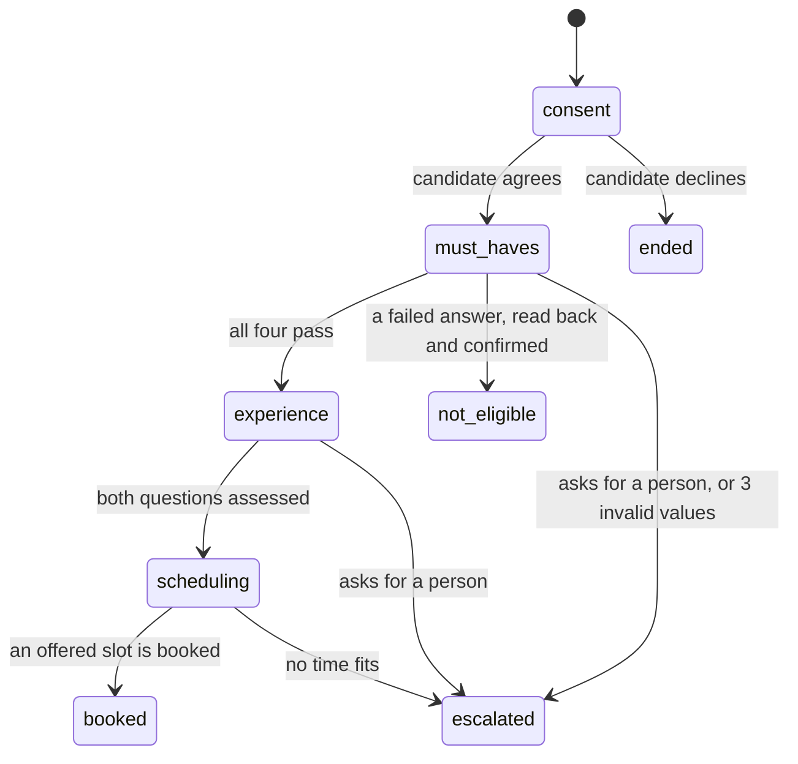
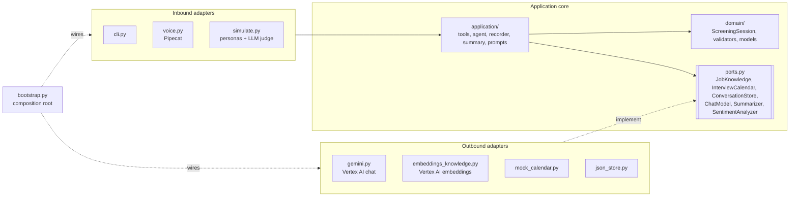

# Harbor Logistics Screening Agent

A voice recruiting agent that runs the first screening call with job candidates.
**Ava** calls a candidate who applied for a warehouse operator role at the fictional company
Harbor Logistics. In about five minutes she checks the must-have requirements, asks two
experience questions with follow-ups, answers the candidate's questions about the job, and books
a video interview with the warehouse manager. The recruiter gets a scorecard with evidence quotes
and a summary, saved as JSON.

The stack runs on Google Cloud, with Deepgram and ElevenLabs as options for speech:

| Layer | Service |
|---|---|
| Transport | Pipecat SmallWebRTC (browser ↔ Python, peer-to-peer audio) |
| Speech-to-text | Google Cloud Speech-to-Text `chirp_3`, or Deepgram `nova-3` (`STT_PROVIDER=deepgram`). Both detect English or Spanish on each utterance |
| LLM | Gemini on Vertex AI (`gemini-3.5-flash` by default) |
| Job knowledge (RAG) | Vertex AI embeddings (`gemini-embedding-001`), ranked in memory |
| Text-to-speech | Google Cloud Text-to-Speech, Chirp 3 HD voices (`en-US`, `es-US`), or ElevenLabs `eleven_flash_v2_5` with one multilingual voice (`TTS_PROVIDER=elevenlabs`) |
| Framework | [Pipecat](https://github.com/pipecat-ai/pipecat) 1.15 |

The same agent also runs as a text chat in the terminal, and against simulated candidates with an
LLM judge, for fast testing without audio.

New to Pipecat or to this codebase? Read [docs/how-it-works.md](docs/how-it-works.md) first.
Why the domain changed from customer support: [ADR-0010](docs/adr/0010-candidate-screening-domain.md).

## What happens in a call



At any stage, the candidate can ask about the job, and Ava answers from the job information.
The candidate can also withdraw (`ended`). A dropped call is saved as `abandoned`.

| Stage | What Ava does | What the code checks |
|---|---|---|
| Consent | Says she is an AI, that a person makes every decision, and asks for consent | Nothing continues without consent |
| Must-haves | Asks about work permit, shifts, start date and commute | Each answer against the job: required shifts, a start within 30 days. A failed answer must be read back and confirmed before it closes the call, because speech recognition can mishear |
| Experience | Asks two behavioral questions (teamwork, safety) | A vague answer gets one follow-up. The evidence quote must appear in the candidate's own words. A still-vague answer cannot score above 2 of 4 |
| Scheduling | Offers two or three free times | Only an offered slot can be booked |
| Closing | Nothing: the code speaks | A fixed message with the time, the reference, or the reason the application stops |

**What Ava never does:** say a score, an assessment, or whether an answer meets a requirement; ask
about age, nationality, health, family or other protected topics; promise the job; invent a job
detail. The simulator's LLM judge checks each of these.

**The recommendation** (`advance`, `review`, `reject`) comes from fixed rules in the domain, not from
Gemini. A recruiter makes the decision. Competency scores never block the booking: only objective
must-haves end an application.

## Job questions (RAG)

The candidate can ask about pay, shifts, location, contract, training or benefits at any time.
Ava calls `search_job_info`. The `JobKnowledge` port finds the matching pieces of
[`data/job_knowledge.json`](data/job_knowledge.json) by embedding similarity, and Ava answers only
from them. A question below the match threshold ("can I bring my dog?") goes on the scorecard as an
open question for the recruiter, and Ava says that the recruiter will answer it.

The index is built once per process, when the first call starts. The threshold (0.68) is measured:
see [ADR-0011](docs/adr/0011-job-knowledge-with-embeddings.md).

## Frustration detection

Each candidate turn is rated for frustration from 0.0 to 1.0 by a small Gemini model, in the
background, so it never delays Ava's reply. A rule in the domain decides the reaction: the first
high reading makes Ava acknowledge it, and two in a row make her offer a call back from a recruiter.
See [docs/features/frustration-detection.md](docs/features/frustration-detection.md).

## Languages

Ava speaks **English** or **Spanish** (formal "usted"). In voice calls, she follows the language that
speech recognition detects on each utterance. Text chat and simulations use `--language es`.
The scorecard, the summary and the tool results stay in English for the recruiting team; the
evidence quotes keep the candidate's own words. See
[docs/features/multi-language.md](docs/features/multi-language.md).

## Setup

### Prerequisites

- Python 3.12 and [uv](https://docs.astral.sh/uv/).
- The [gcloud CLI](https://cloud.google.com/sdk/docs/install).
- A Google Cloud project with billing enabled.
- Chrome, Edge or Firefox for the voice demo.

### 1. Install the dependencies

```bash
uv sync
```

### 2. Configure Google Cloud

1. Select your project:
   ```bash
   gcloud config set project <PROJECT_ID>
   ```
2. Enable the three APIs:
   ```bash
   gcloud services enable speech.googleapis.com texttospeech.googleapis.com aiplatform.googleapis.com
   ```
3. Log in with Application Default Credentials (ADC):
   ```bash
   gcloud auth application-default login
   ```
4. Set the quota project for ADC. If you skip this step, Speech and TTS calls can fail with a quota or permission error.
   ```bash
   gcloud auth application-default set-quota-project <PROJECT_ID>
   ```

### 3. Create the `.env` file

```bash
cp .env.example .env
```

Set `GOOGLE_CLOUD_PROJECT` in `.env`. Every other value has a default in
[`config/settings.toml`](config/settings.toml): models, voices, locations, timeouts and thresholds.
`.env` holds secrets and per-machine overrides; [`.env.example`](.env.example) lists them, and
`ENV_OVERRIDES` in `config.py` maps each variable to its setting.

## Run

| Command | What it does |
|---|---|
| `uv run screening-agent voice` | Starts the voice server. Open <http://localhost:7860> and click **Connect** |
| `uv run screening-agent chat` | Text chat in the terminal. Type `/quit` to leave |
| `uv run screening-agent simulate` | Runs eight simulated candidates, each checked by status and by an LLM judge |
| `--language es` | Add it to `chat` or `simulate` to run the conversation in Spanish. On `voice`, it makes Ava greet in Spanish |
| `uv run pytest` | Runs the unit and conversation tests (no network needed) |

Each conversation is saved to `conversations/<id>.json`: the transcript with frustration readings,
every tool call, the scorecard, and the summary. See
[`examples/sample_conversation.json`](examples/sample_conversation.json) for a real run: a candidate
who asks three job questions (one with no answer, which goes to the recruiter) and books an interview.

## Architecture

The code follows **hexagonal architecture (ports and adapters)**. Dependencies point inward only:
adapters depend on the application, the application depends on the domain, and the domain
depends on nothing in the project. `tests/test_architecture.py` enforces this rule.


> **Interactive version:** [`docs/diagrams/architecture.html`](docs/diagrams/architecture.html), one standalone page
> with animated data flow, search, focus on a component, a dark theme, and PNG/SVG export. Each component links
> to the source lines it comes from. The source of the diagram is
> [`docs/diagrams/architecture.json`](docs/diagrams/architecture.json), rendered with Archify.



A new provider is a new adapter. Deepgram (speech-to-text) and ElevenLabs (text-to-speech) are
two: `STT_PROVIDER` and `TTS_PROVIDER` choose the service in `adapters/inbound/speech.py`, with no
change to the domain or the tools ([ADR-0012](docs/adr/0012-deepgram-speech-to-text.md),
[ADR-0013](docs/adr/0013-elevenlabs-text-to-speech.md)).

### Tools the LLM can call

| Tool | Effect |
|---|---|
| `start_screening(candidate_name, consent)` | Starts the screening, or ends the call without consent |
| `record_must_have(requirement, answer, confirmed?)` | Validates the answer against the job. A failure asks for a read-back first; a confirmed failure closes the call as `not_eligible` |
| `record_answer(question_id, summary, evidence_quote, specificity, score)` | Checks the quote against the candidate's words. A vague answer gets one follow-up |
| `search_job_info(question)` | Finds job information. No match: the question goes to the recruiter |
| `get_interview_slots()` | Free times from the calendar port |
| `book_interview(slot_id)` | Books an offered slot and closes the call with the time and reference |
| `escalate_to_human(reason)` | A recruiter calls back |
| `end_conversation(reason)` | The candidate withdraws |

### Project structure

```
src/screening_agent/
├── domain/                  # Pure business rules. Imports nothing from the project
│   ├── models.py            # JobPosting, Scorecard, ConversationRecord, Summary
│   ├── validators.py        # Yes/no, shifts, dates, scores, the evidence quote check
│   ├── state.py             # ScreeningSession: the state machine and the recommendation
│   └── frustration.py       # FrustrationPolicy: readings → acknowledge / offer a recruiter
├── application/             # Use cases. Depends on the domain and its own ports only
│   ├── ports.py             # JobKnowledge, InterviewCalendar, ConversationStore, ChatModel, …
│   ├── tools.py             # Tool specs (SDK-neutral) and the async ToolExecutor
│   ├── agent.py             # TextAgent: the turn loop for text and simulations
│   ├── recorder.py          # Transcript, tool calls, saves after each turn, final summary
│   ├── summary.py           # Recruiter summary, with a rule-based fallback
│   ├── sentiment.py         # SentimentMonitor: rates each candidate turn in the background
│   ├── prompts.py           # System prompt: the call flow, the voice, the rules
│   └── messages.py          # Fixed closing messages and spoken dates for each language
├── adapters/
│   ├── inbound/             # cli.py, voice.py (Pipecat), simulate.py (personas + judge)
│   └── outbound/            # gemini.py, embeddings_knowledge.py, mock_calendar.py,
│                            # json_job.py, json_store.py
├── bootstrap.py             # Composition root: wires adapters to ports
└── config.py                # Settings from .env
data/job.json                # The role: required shifts, start limit, experience questions
data/job_knowledge.json      # Job information for RAG
```

## Key design decisions

The main decisions, with the alternatives we rejected, are recorded as ADRs in [`docs/adr/`](docs/adr/).

| Decision | Reason |
|---|---|
| **Code owns the outcome, not the LLM** | Gemini proposes values through tool calls. `ScreeningSession` validates them, decides the stage and calculates the recommendation. Gemini cannot book before the screening, or close on a failed must-have without a read-back |
| **Evidence quotes are checked** | Every score points to the candidate's own words. The domain rejects a quote that is not in the transcript, so a recruiter can trust the scorecard |
| **Silent assessment** | Ava never says a score or a requirement result. The fixed closing message gives the outcome, in the candidate's language |
| **Fixed closing messages** | The booking time, the reference and the reason come from code. Voice speaks them with `TTSSpeakFrame` and ends the call. The LLM does not run again |
| **RAG behind a port** | Job answers come only from the job information. A failed or empty search sends the question to the recruiter and never breaks the call |
| **Hexagonal architecture** | The domain and application have no SDK imports. Gemini, Pipecat, the embeddings and the calendar are adapters behind ports. A test enforces the direction |
| **One core, three inbound adapters** | Text, voice and simulations share the state machine, tools, recorder and storage |
| **Cascaded STT → LLM → TTS** | Each stage can be inspected and logged, and each can change provider on its own |

## Testing

- **`uv run pytest`** runs the tests in about a second, with no network. The folders mirror the layers:
  - `tests/domain/`: every state-machine rule (consent, must-haves with read-back, follow-ups, quote check, booking, recommendation), the validators in English and Spanish, and the frustration policy.
  - `tests/application/`: the tool executor (including a failed search), the messages in every language, and full calls through the agent loop with a scripted `ChatModel`.
  - `tests/adapters/`: the RAG ranking and index with a fake embeddings client, the mock calendar, Gemini response parsing, and the voice handlers.
- **`uv run screening-agent simulate`** runs Gemini as eight candidates against the real agent: strong,
  vague then specific (needs a follow-up), no work permit, corrects a misheard start date, asks many
  questions (one with no answer), wants a person, grows more frustrated (must be offered a
  recruiter call back without asking), and tries to game the score. Each run passes only if
  the final status is right **and** an LLM judge passes six criteria: natural tone, follow-ups, no
  leaks, no protected topics, grounded job answers, and a faithful scorecard.

## Potential improvements

| Area | Improvement |
|---|---|
| Voice | Measure Deepgram and ElevenLabs against Google on real calls: time to first audio, accuracy on names and dates |
| Latency | Measure time-to-first-audio per stage with Pipecat metrics. Overlap the job search with a short filler phrase |
| Product | A recruiter view of the scorecards. Several roles, each with its own questions and knowledge |
| Calendar | Replace the mock with Google Calendar through the same port |
| Evaluation | Run the simulator in CI. Track the judge results over time, and calibrate the judge on human-rated calls |
| Compliance | Data retention and deletion for candidate records. A bias review of the scoring on real calls |
| Production | Telephony (Twilio) as a new transport. Deploy on Cloud Run. Tracing and dashboards |

## Known limitations

- The voice channel and the live Gemini calls need a configured GCP project with the three APIs enabled.
  The offline tests use fakes for every Google service.
- The browser client is Pipecat's generic prebuilt UI. It shows a camera button that this audio-only
  agent does not use.
- Each job question adds one tool round trip (about 0.5 to 1.5 s) in a voice call.
- The domain checks every must-have answer, but it cannot prove that Ava asked the question. "Ask about
  all four requirements, and never assume an answer" is a prompt rule, and the LLM judge checks it in
  the simulator. In one run before that rule, Gemini saved a work permit that the candidate never stated.
- Gemini rates the experience answers. The domain bounds the scores (follow-ups, the quote check, the
  cap for vague answers), but the rating itself is a model judgment, not a fixed rule.
