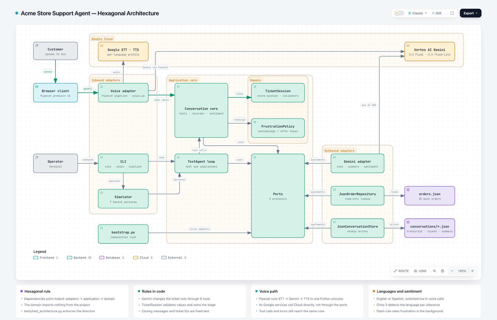
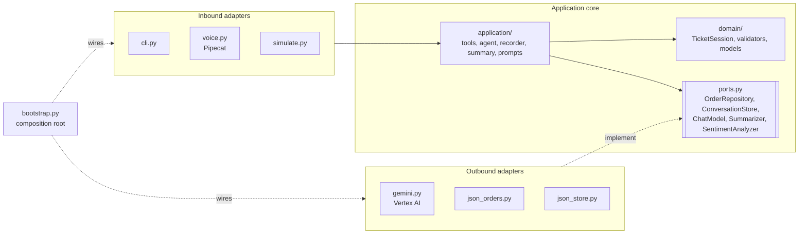
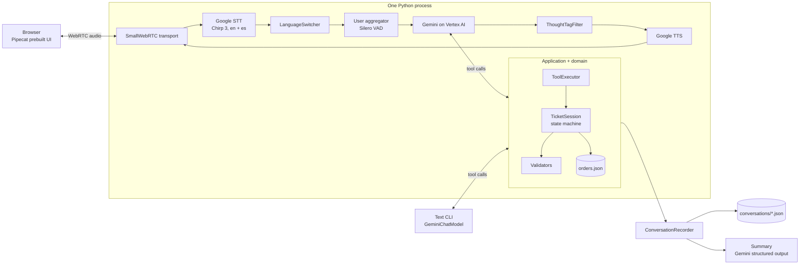
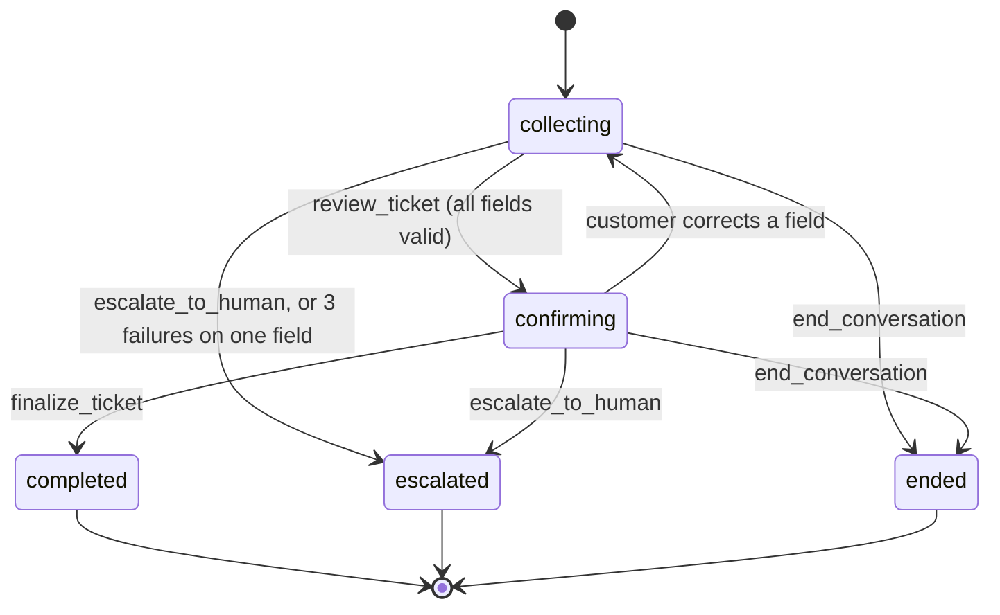

# Acme Store Support Agent

A voice customer-support agent for a fictional online electronics store.
The customer talks to the agent in the browser. The agent collects the details of
the problem, checks them, and saves a validated ticket and a summary as JSON.

**Demo video (about 5 min):** [three sample calls on Loom](https://www.loom.com/share/0ce134ab2afa44969e9463f6c0f16301): a full ticket with an invalid order
number, an angry customer escalated to a human, and a live switch to Spanish.

The whole stack runs on Google Cloud:

| Layer | Service |
|---|---|
| Transport | Pipecat SmallWebRTC (browser ↔ Python, peer-to-peer audio) |
| Speech-to-text | Google Cloud Speech-to-Text `chirp_3` (streaming, phrase hints), detecting English or Spanish on each utterance |
| LLM | Gemini on Vertex AI (`gemini-3.5-flash` by default) |
| Text-to-speech | Google Cloud Text-to-Speech, Chirp 3 HD voices (`en-US`, `es-US`) |
| Framework | [Pipecat](https://github.com/pipecat-ai/pipecat) 1.15 |

The same agent also runs as a text chat in the terminal, for fast testing without audio.

New to Pipecat or to this codebase? Read [docs/how-it-works.md](docs/how-it-works.md) first.
For the requirement checklist and what was added beyond the brief, see [docs/spec.md](docs/spec.md).

## What the agent collects

| Field | Validation |
|---|---|
| `order_number` | Normalized from spoken forms ("o r d one zero four…" → `ORD-104233`), then looked up in the order database |
| `category` | `shipping`, `billing`, `product_defect`, `return_refund`, `account`, `other` (with aliases such as "refund", "damaged") |
| `description` | 10 to 1000 characters, whitespace cleaned |
| `urgency` | `low`, `medium`, `high` (aliases such as "urgent", "normal"). The agent infers it, then confirms it |

The mock order database is in [`data/orders.json`](data/orders.json) (10 orders with different statuses).

## Frustration detection

Each customer turn is rated for frustration from 0.0 to 1.0 by a small Gemini model
(`gemini-3.5-flash-lite`). The rating runs in the background, so it never delays Ava's reply.
A rule in the domain decides the reaction:

| Readings | Ava's next reply |
|---|---|
| Below 0.7 | No change |
| First reading ≥ 0.7 | Briefly acknowledges the frustration |
| Two readings ≥ 0.7 in a row | Acknowledges it and offers a human agent (once per call) |

Each reading is saved on its transcript turn (`sentiment`: score, reason, action), and the summary's
`customer_sentiment` uses them. The full description is in [docs/features/frustration-detection.md](docs/features/frustration-detection.md),
and [ADR-0007](docs/adr/0007-frustration-detection.md) records the options we compared.

## Languages

Ava speaks **English** or **Spanish**.

- **Voice calls switch live.** Speech recognition detects the language of each utterance. When the customer
  changes language, Ava changes her voice, her replies and her closing message on the same turn.
- **Text chat and simulations** use one language, set with `--language es` or `DEFAULT_LANGUAGE` in `.env`.
  In voice calls, these settings choose only the greeting language.

Spanish uses the formal "usted". Tool results and the summary stay in English for the support team.
See [docs/features/multi-language.md](docs/features/multi-language.md),
[ADR-0008](docs/adr/0008-language-fixed-per-conversation.md) and
[ADR-0009](docs/adr/0009-detect-the-language-in-voice-calls.md).

## Setup

### Prerequisites

- Python 3.12 and [uv](https://docs.astral.sh/uv/).
- The [gcloud CLI](https://cloud.google.com/sdk/docs/install).
- A Google Cloud project with billing enabled.
- Chrome, Edge or Firefox for the voice demo.

### 1. Install the dependencies

```bash
uv sync
```

### 2. Configure Google Cloud

1. Select your project:
   ```bash
   gcloud config set project <PROJECT_ID>
   ```
2. Enable the three APIs:
   ```bash
   gcloud services enable speech.googleapis.com texttospeech.googleapis.com aiplatform.googleapis.com
   ```
3. Log in with Application Default Credentials (ADC):
   ```bash
   gcloud auth application-default login
   ```
4. Set the quota project for ADC. If you skip this step, Speech and TTS calls can fail with a quota or permission error.
   ```bash
   gcloud auth application-default set-quota-project <PROJECT_ID>
   ```

### 3. Create the `.env` file

```bash
cp .env.example .env
```

Set `GOOGLE_CLOUD_PROJECT` in `.env`. The other values have working defaults.
See [`.env.example`](.env.example) for all settings.

A service-account key also works: set `GOOGLE_APPLICATION_CREDENTIALS=/path/key.json`.
The key needs the *Vertex AI User* and *Cloud Speech Client* roles.

## Run

| Command | What it does |
|---|---|
| `uv run support-agent voice` | Starts the voice server. Open <http://localhost:7860> and click **Connect** |
| `uv run support-agent chat` | Text chat in the terminal. Type `/quit` to leave |
| `uv run support-agent simulate` | Runs seven simulated customers against the agent and prints PASS/FAIL |
| `--language es` | Add it to `chat` or `simulate` to run the conversation in Spanish. On `voice`, it makes Ava greet in Spanish |
| `uv run pytest` | Runs the unit and conversation tests (no network needed) |

Example orders to try: `ORD-104233` (delivered headphones), `ORD-208871` (shipped monitor),
`ORD-600118` (laptop still processing).

Each conversation is saved to `conversations/<id>.json`.
See [`examples/sample_conversation.json`](examples/sample_conversation.json) for the format.
That sample is a real voice call: a wrong order number first, then a completed ticket, with a frustration
reading on each customer turn and a summary written by Gemini.

## Architecture

The code follows **hexagonal architecture (ports and adapters)**. Dependencies point inward only:
adapters depend on the application, the application depends on the domain, and the domain
depends on nothing in the project. `tests/test_architecture.py` enforces this rule.



> **Interactive version:** [`docs/diagrams/architecture.html`](docs/diagrams/architecture.html) is the same diagram as
> one standalone page, with animated data flow, search, focus on a component, a dark theme, and PNG/SVG export.
> GitHub shows HTML files as source code, so open it from a local clone, or download it and open it in a browser.
> The diagram's source is [`docs/diagrams/architecture.json`](docs/diagrams/architecture.json), rendered with Archify.



### Runtime view (voice)



The voice server is one process. The Pipecat development runner serves the browser page and the
WebRTC signaling endpoint. After the handshake, audio flows directly between the browser and the
Python process. Each browser connection gets its own pipeline, ticket and record.
`LanguageSwitcher` follows the language that STT detects (see Languages above). `ThoughtTagFilter` removes
`<thought>` tags that Gemini sometimes writes as reply text, before TTS speaks them.

### State machine



A dropped call or a closed chat while the ticket is open is saved as `abandoned`.

### Tools the LLM can call

| Tool | Effect |
|---|---|
| `lookup_order(order_number)` | Normalizes the number, finds the order, attaches it and the customer name to the ticket |
| `update_ticket(category?, description?, urgency?)` | Partial update. Each field is validated separately. Returns rejected values, missing fields and warnings |
| `review_ticket()` | Refused if a field is missing. Otherwise moves to `confirming` and returns the ticket to read back |
| `finalize_ticket()` | Refused unless the stage is `confirming`. Creates the ticket ID and closes the conversation |
| `escalate_to_human(reason)` | Closes the conversation as `escalated` |
| `end_conversation(reason)` | Closes the conversation without a ticket |

### Project structure

```
src/support_agent/
├── domain/                  # Pure business rules. Imports nothing from the project
│   ├── models.py            # Pydantic models: Order, Ticket, ConversationRecord, Summary
│   ├── validators.py        # Order-number normalizer, category/urgency parsers, description check
│   ├── state.py             # TicketSession: the state machine and validation rules
│   └── frustration.py       # FrustrationPolicy: readings → acknowledge / offer a human
├── application/             # Use cases. Depends on the domain and its own ports only
│   ├── ports.py             # OrderRepository, ConversationStore, ChatModel, Summarizer, SentimentAnalyzer
│   ├── tools.py             # Tool specs (SDK-neutral) and ToolExecutor
│   ├── agent.py             # TextAgent: the turn loop for text and simulations
│   ├── recorder.py          # Transcript, tool calls, saves after each turn, final summary
│   ├── summary.py           # Summary input, SafeSummarizer, rule-based fallback
│   ├── sentiment.py         # SentimentMonitor: rates each customer turn in the background
│   ├── prompts.py           # System prompt, with channel style and language rules
│   └── messages.py          # Fixed closing messages for each language
├── adapters/
│   ├── inbound/             # Driving adapters: how customers and operators reach the app
│   │   ├── cli.py           # support-agent chat | voice | simulate
│   │   ├── voice.py         # Pipecat pipeline: WebRTC → STT → Gemini → TTS
│   │   └── simulate.py      # Simulated customer personas
│   └── outbound/            # Driven adapters: implementations of the ports
│       ├── gemini.py        # Vertex AI client, GeminiChatModel, GeminiSummarizer
│       ├── json_orders.py   # JsonOrderRepository
│       └── json_store.py    # JsonConversationStore (atomic writes)
├── bootstrap.py             # Composition root: wires adapters to ports
└── config.py                # Settings from .env
tests/                       # Mirrors the layers: domain/, application/, adapters/
├── test_architecture.py     # Fails if a layer imports outward
data/orders.json             # Mock orders
docs/how-it-works.md         # Guided explanation of the system
```

## Key design decisions

The main decisions, with the alternatives we rejected, are recorded as ADRs in [`docs/adr/`](docs/adr/):
[0001 code owns the ticket state](docs/adr/0001-code-owns-the-ticket-state.md),
[0002 Google Cloud only](docs/adr/0002-google-cloud-only-stack.md),
[0003 cascaded pipeline](docs/adr/0003-cascaded-voice-pipeline.md),
[0004 Pipecat in one process](docs/adr/0004-pipecat-single-process-webrtc.md),
[0005 hexagonal architecture](docs/adr/0005-hexagonal-architecture.md),
[0006 no Pipecat Flows](docs/adr/0006-own-state-machine-not-pipecat-flows.md),
[0007 frustration detection](docs/adr/0007-frustration-detection.md),
[0008 language per conversation](docs/adr/0008-language-fixed-per-conversation.md),
[0009 live language switch in voice](docs/adr/0009-detect-the-language-in-voice-calls.md).

| Decision | Reason |
|---|---|
| **Code decides completion, not the LLM** | The LLM proposes values through tool calls. `TicketSession` validates them and owns the stage. The LLM cannot finalize without a read-back, or skip a missing field. This makes the flow predictable and testable |
| **Validation errors go back to the LLM** | A rejected value returns a short reason. The LLM tells the customer and asks again. After 3 failures on one field, the session escalates, so the customer is never stuck in a loop |
| **Validation against data, not only format** | `lookup_order` checks that the order exists. It returns the order status, so the agent can use it ("your headphones were delivered on October 16"). A warning appears when the category does not fit the status, e.g. a defect on an undelivered order |
| **Fixed closing messages** | When a conversation closes, the executor returns a fixed message with the ticket ID. Voice speaks it with `TTSSpeakFrame` and ends the call. The LLM does not run again, so it cannot invent a reference number |
| **Hexagonal architecture** | The domain and application have no SDK imports. Gemini, Pipecat and the JSON files are adapters behind ports, so each can change without touching the rules. A test enforces the dependency direction |
| **The domain receives a lookup function, not a repository** | `TicketSession` takes `find_order: Callable[[str], Order \| None]`. The domain stays free of any port or adapter import, and tests pass a plain function or dict lookup |
| **One core, three inbound adapters** | Text, voice and simulations share the state machine, tools, recorder and storage. Only the LLM loop differs. The CLI gives a fast, cheap test loop, and the core is unit-tested without audio or network |
| **Cascaded STT → LLM → TTS, not speech-to-speech** | Matches the brief (separate transcription and TTS). STT phrase hints improve order-number recognition. Each stage can be inspected and logged |
| **All Google Cloud** | One vendor and one auth method (ADC). Pipecat has native Google STT, TTS and Vertex AI services |
| **Spoken-form normalization in code** | STT writes order numbers in many ways ("OR D", "one oh four", "double three"). Deterministic normalization is cheaper and more reliable than asking the LLM to clean them |
| **Save after every turn** | A crash or a dropped call keeps a partial record. Files are written atomically (temporary file + rename) |
| **Summary with a fallback** | The summary uses Gemini structured output (a Pydantic schema). If the call fails, a rule-based summary is saved instead, so every record has one |
| **Pipecat development runner** | It serves the prebuilt browser UI and WebRTC signaling, so there is no separate frontend build |

### Error handling

| Case | Behavior |
|---|---|
| Invalid or unknown value | Rejected with a reason; the agent asks again; logged in `validation_events` |
| Same field fails 3 times | Automatic escalation to a human |
| Customer corrects a value after the read-back | The confirmation is reset; the agent must read back again |
| Gemini writes a `<thought>` tag as reply text | The tag is removed before TTS, the transcript and the record. A closed `<thought>…</thought>` block is dropped |
| Off-topic input, garbled transcript | The prompt tells the agent to redirect, or to ask the customer to repeat |
| Customer asks for a human, safety issue | `escalate_to_human` |
| LLM calls tools in a loop (text channel) | Stopped after 6 rounds; the agent asks the customer to repeat |
| Tool called after the conversation closed | Refused |
| Gemini API errors (text channel, summaries) | Retried 3 times with backoff (`google-genai` retry options); then the chat stops and saves the record. In voice, Pipecat's Google services handle errors |
| Summary call fails | Rule-based fallback summary |
| Sentiment call fails or takes more than 5 s | The turn has no reading; the conversation continues normally |
| Missing project or expired credentials | Clear message with the `gcloud` command to run |
| Browser disconnects | Pipeline stops; the record is saved as `abandoned` with a summary |

## Testing

- **`uv run pytest`** runs 151 tests in under a second, with no network. The folders mirror the layers:
  - `tests/domain/`: validators (English and Spanish forms), every state-machine rule, and the frustration policy.
  - `tests/application/`: the tool executor, the sentiment monitor (including failures and timeouts), the message catalog in every language, and full conversations through the agent loop with a scripted `ChatModel`.
  - `tests/adapters/`: Gemini response parsing with a fake client, the voice tool handler, the voice guidance sender, the voice profiles for each language, and the live language switcher.
  - `tests/test_architecture.py`: one check per file that the layer imports only inward.
- **`uv run support-agent simulate`** runs Gemini as seven customer personas against the real agent:
  cooperative, wrong order number first, correction during read-back, rambling, demands a human,
  growing frustration (must be offered a human without asking), and never gives a valid order number. Each persona has an expected outcome, and the command
  exits with code 1 if one fails. Use `--persona <name>` to run one, and `--language es` to run them in Spanish.

## Potential improvements

| Area | Improvement |
|---|---|
| Speech | Use word confidence from Google STT to ask for a repeat before extraction. Add a custom phrase set with all valid order prefixes |
| Sentiment | Add acoustic signals (tone, volume, speech rate) to the text-based frustration score. Tune the thresholds on real calls |
| Latency | Measure time-to-first-audio per stage with Pipecat metrics. Try Gemini Live (speech-to-speech) on Vertex AI for lower latency, and compare extraction accuracy |
| Knowledge (RAG) | Let Ava answer policy questions from a knowledge base of common issues, through a `KnowledgeBase` port and a Vertex AI RAG Engine adapter. Not part of this delivery: see [spec section 7](docs/spec.md#7-not-delivered-rag-over-a-knowledge-base) |
| Identity | Verify the customer (email or postcode) against the order before sharing order details |
| Conversation | Handle silence with a user-idle timeout. Support several problems in one call |
| Languages | Add live switching to the text channel. Add a language selector to the browser client for the greeting. Add more languages (see the steps in the feature document) |
| Data | Replace the JSON files with a database by adding a new `ConversationStore` adapter (Firestore or Cloud SQL). Send tickets to a real helpdesk (Zendesk, Jira). Keep the call audio for quality review |
| Evaluation | Run the simulated customers in CI, add more personas, and score the summaries with an LLM judge. Add audio-level evals with `pipecat eval` |
| Production | Split the signaling server and the bot workers, so heavy calls scale separately. Deploy on Cloud Run. Use a TURN server for restrictive networks. Add tracing and dashboards |
| Security | Redact personal data in logs and records. Add a retention policy for conversation files |

## Known limitations

- The voice channel and the live Gemini calls need a configured GCP project with the three APIs enabled.
  The offline tests use fakes for every Google service.
- The browser client is Pipecat's generic prebuilt UI. It shows a camera button and a bot video area that
  this audio-only agent does not use. The UI cannot hide them without a custom client.
- Gemini can still write a short announcement of its own just before a transfer, next to the fixed
  closing message. The prompt forbids it, but a prompt rule is not a guarantee.
- The default model is `gemini-3.5-flash`, not Pipecat's default `gemini-3.8-flash`. In a measurement on
  the `global` endpoint, 3.8 Flash took 2 to 20 seconds per model round, and a voice turn with a tool call
  needs two rounds. 3.5 Flash took about 0.8 seconds per round and passed all simulated customers in both
  languages. If your project does not have it, set `GEMINI_MODEL` to a model that Vertex AI Model Garden lists.
