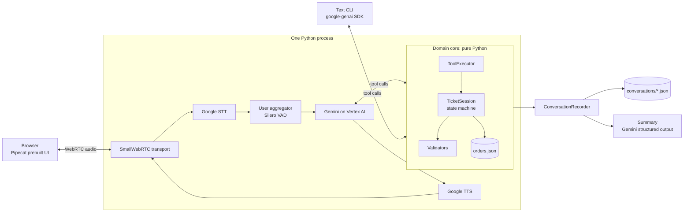
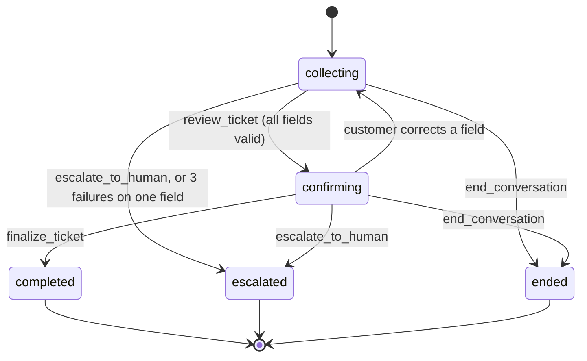

# Orbio Store Support Agent

A voice customer-support agent for a fictional online electronics store.
The customer talks to the agent in the browser. The agent collects the details of
the problem, checks them, and saves a validated ticket and a summary as JSON.

The whole stack runs on Google Cloud:

| Layer | Service |
|---|---|
| Transport | Pipecat SmallWebRTC (browser ↔ Python, peer-to-peer audio) |
| Speech-to-text | Google Cloud Speech-to-Text (streaming, `latest_long`, phrase hints) |
| LLM | Gemini on Vertex AI (`gemini-3.8-flash` by default) |
| Text-to-speech | Google Cloud Text-to-Speech, Chirp 3 HD voice |
| Framework | [Pipecat](https://github.com/pipecat-ai/pipecat) 1.15 |

The same agent also runs as a text chat in the terminal, for fast testing without audio.

## What the agent collects

| Field | Validation |
|---|---|
| `order_number` | Normalized from spoken forms ("o r d one zero four…" → `ORD-104233`), then looked up in the order database |
| `category` | `shipping`, `billing`, `product_defect`, `return_refund`, `account`, `other` (with aliases such as "refund", "damaged") |
| `description` | 10 to 1000 characters, whitespace cleaned |
| `urgency` | `low`, `medium`, `high` (aliases such as "urgent", "normal"). The agent infers it, then confirms it |

The mock order database is in [`data/orders.json`](data/orders.json) (10 orders with different statuses).

## Setup

### Prerequisites

- Python 3.12 and [uv](https://docs.astral.sh/uv/).
- The [gcloud CLI](https://cloud.google.com/sdk/docs/install).
- A Google Cloud project with billing enabled.
- Chrome, Edge or Firefox for the voice demo.

### 1. Install the dependencies

```bash
uv sync
```

### 2. Configure Google Cloud

1. Select your project:
   ```bash
   gcloud config set project <PROJECT_ID>
   ```
2. Enable the three APIs:
   ```bash
   gcloud services enable speech.googleapis.com texttospeech.googleapis.com aiplatform.googleapis.com
   ```
3. Log in with Application Default Credentials (ADC):
   ```bash
   gcloud auth application-default login
   ```
4. Set the quota project for ADC. If you skip this step, Speech and TTS calls can fail with a quota or permission error.
   ```bash
   gcloud auth application-default set-quota-project <PROJECT_ID>
   ```

### 3. Create the `.env` file

```bash
cp .env.example .env
```

Set `GOOGLE_CLOUD_PROJECT` in `.env`. The other values have working defaults.
See [`.env.example`](.env.example) for all settings.

A service-account key also works: set `GOOGLE_APPLICATION_CREDENTIALS=/path/key.json`.
The key needs the *Vertex AI User* and *Cloud Speech Client* roles.

## Run

| Command | What it does |
|---|---|
| `uv run support-agent voice` | Starts the voice server. Open <http://localhost:7860> and click **Connect** |
| `uv run support-agent chat` | Text chat in the terminal. Type `/quit` to leave |
| `uv run support-agent simulate` | Runs six simulated customers against the agent and prints PASS/FAIL |
| `uv run pytest` | Runs the unit and conversation tests (no network needed) |

Example orders to try: `ORD-104233` (delivered headphones), `ORD-208871` (shipped monitor),
`ORD-600118` (laptop still processing).

Each conversation is saved to `conversations/<id>.json`.
See [`examples/sample_conversation.json`](examples/sample_conversation.json) for the format.
That sample comes from a scripted test model, so its summary uses the rule-based fallback
(`"generated_by": "fallback"`). A live run uses Gemini for the summary.

## Architecture



The voice server is one process. The Pipecat development runner serves the browser page and the
WebRTC signaling endpoint. After the handshake, audio flows directly between the browser and the
Python process. Each browser connection gets its own pipeline, ticket and record.

### State machine



A dropped call or a closed chat while the ticket is open is saved as `abandoned`.

### Tools the LLM can call

| Tool | Effect |
|---|---|
| `lookup_order(order_number)` | Normalizes the number, finds the order, attaches it and the customer name to the ticket |
| `update_ticket(category?, description?, urgency?)` | Partial update. Each field is validated separately. Returns rejected values, missing fields and warnings |
| `review_ticket()` | Refused if a field is missing. Otherwise moves to `confirming` and returns the ticket to read back |
| `finalize_ticket()` | Refused unless the stage is `confirming`. Creates the ticket ID and closes the conversation |
| `escalate_to_human(reason)` | Closes the conversation as `escalated` |
| `end_conversation(reason)` | Closes the conversation without a ticket |

### Project structure

```
src/support_agent/
├── models.py         # Pydantic models: Order, Ticket, ConversationRecord, Summary
├── validators.py     # Order-number normalizer, category/urgency parsers, description check
├── orders.py         # Mock order repository
├── state.py          # TicketSession: the state machine and validation rules
├── tools.py          # Tool specs (SDK-neutral) and ToolExecutor
├── recorder.py       # Transcript, tool calls, saves after each turn, final summary
├── storage.py        # Atomic JSON file storage
├── summary.py        # Gemini structured-output summary + rule-based fallback
├── prompts.py        # System prompt, with voice and text style variants
├── conversation.py   # Builds session + recorder + executor for one conversation
├── gemini.py         # Vertex AI client with retries and timeout
├── text_agent.py     # Text channel: agent loop with manual function calling
├── simulate.py       # Simulated customer personas
├── cli.py            # support-agent chat | voice | simulate
└── voice/bot.py      # Pipecat pipeline: WebRTC → STT → Gemini → TTS
tests/                # Validators, state machine, tools, text agent, voice handler
data/orders.json      # Mock orders
```

## Key design decisions

| Decision | Reason |
|---|---|
| **Code decides completion, not the LLM** | The LLM proposes values through tool calls. `TicketSession` validates them and owns the stage. The LLM cannot finalize without a read-back, or skip a missing field. This makes the flow predictable and testable |
| **Validation errors go back to the LLM** | A rejected value returns a short reason. The LLM tells the customer and asks again. After 3 failures on one field, the session escalates, so the customer is never stuck in a loop |
| **Validation against data, not only format** | `lookup_order` checks that the order exists. It returns the order status, so the agent can use it ("your headphones were delivered on October 16"). A warning appears when the category does not fit the status, e.g. a defect on an undelivered order |
| **Fixed closing messages** | When a conversation closes, the executor returns a fixed message with the ticket ID. Voice speaks it with `TTSSpeakFrame` and ends the call. The LLM does not run again, so it cannot invent a reference number |
| **One domain core, two channels** | Text and voice share the state machine, tools, recorder and storage. Only the LLM loop differs. The CLI gives a fast, cheap test loop, and the core is unit-tested without audio or network |
| **Cascaded STT → LLM → TTS, not speech-to-speech** | Matches the brief (separate transcription and TTS). STT phrase hints improve order-number recognition. Each stage can be inspected and logged |
| **All Google Cloud** | One vendor and one auth method (ADC). Pipecat has native Google STT, TTS and Vertex AI services |
| **Spoken-form normalization in code** | STT writes order numbers in many ways ("OR D", "one oh four", "double three"). Deterministic normalization is cheaper and more reliable than asking the LLM to clean them |
| **Save after every turn** | A crash or a dropped call keeps a partial record. Files are written atomically (temporary file + rename) |
| **Summary with a fallback** | The summary uses Gemini structured output (a Pydantic schema). If the call fails, a rule-based summary is saved instead, so every record has one |
| **Pipecat development runner** | It serves the prebuilt browser UI and WebRTC signaling, so there is no separate frontend build |

### Error handling

| Case | Behavior |
|---|---|
| Invalid or unknown value | Rejected with a reason; the agent asks again; logged in `validation_events` |
| Same field fails 3 times | Automatic escalation to a human |
| Customer corrects a value after the read-back | The confirmation is reset; the agent must read back again |
| Off-topic input, garbled transcript | The prompt tells the agent to redirect, or to ask the customer to repeat |
| Customer asks for a human, safety issue | `escalate_to_human` |
| LLM calls tools in a loop (text channel) | Stopped after 6 rounds; the agent asks the customer to repeat |
| Tool called after the conversation closed | Refused |
| Gemini API errors (text channel, summaries) | Retried 3 times with backoff (`google-genai` retry options); then the chat stops and saves the record. In voice, Pipecat's Google services handle errors |
| Summary call fails | Rule-based fallback summary |
| Missing project or expired credentials | Clear message with the `gcloud` command to run |
| Browser disconnects | Pipeline stops; the record is saved as `abandoned` with a summary |

## Testing

- **`uv run pytest`** runs 52 tests in under a second, with no network: validators, every
  state-machine rule, the tool executor, Gemini response parsing with a fake client,
  full text conversations with a scripted model,
  and the voice tool handler (closing message and end of call).
- **`uv run support-agent simulate`** runs Gemini as six customer personas against the real agent:
  cooperative, wrong order number first, correction during read-back, rambling, demands a human,
  and never gives a valid order number. Each persona has an expected outcome, and the command
  exits with code 1 if one fails. Use `--persona <name>` to run one.

## Potential improvements

| Area | Improvement |
|---|---|
| Speech | Use word confidence from Google STT to ask for a repeat before extraction. Try the Chirp 3 STT model. Add a custom phrase set with all valid order prefixes |
| Latency | Measure time-to-first-audio per stage with Pipecat metrics. Try Gemini Live (speech-to-speech) on Vertex AI for lower latency, and compare extraction accuracy |
| Identity | Verify the customer (email or postcode) against the order before sharing order details |
| Conversation | Handle silence with a user-idle timeout. Support several problems in one call. Support more languages |
| Data | Replace JSON files with a database (Firestore or Cloud SQL). Send tickets to a real helpdesk (Zendesk, Jira). Keep the call audio for quality review |
| Evaluation | Run the simulated customers in CI, add more personas, and score the summaries with an LLM judge. Add audio-level evals with `pipecat eval` |
| Production | Split the signaling server and the bot workers, so heavy calls scale separately. Deploy on Cloud Run. Use a TURN server for restrictive networks. Add tracing and dashboards |
| Security | Redact personal data in logs and records. Add a retention policy for conversation files |

## Known limitations

- The voice channel and the live Gemini calls need a configured GCP project. They were built against
  the Pipecat 1.15 and `google-genai` APIs, and the offline tests cover the tool handler. The full audio
  path must still be tried end to end with real credentials.
- `gemini-3.8-flash` is Pipecat's current default model. If your project does not have it,
  set `GEMINI_MODEL` to a model that Vertex AI Model Garden lists for your project.
