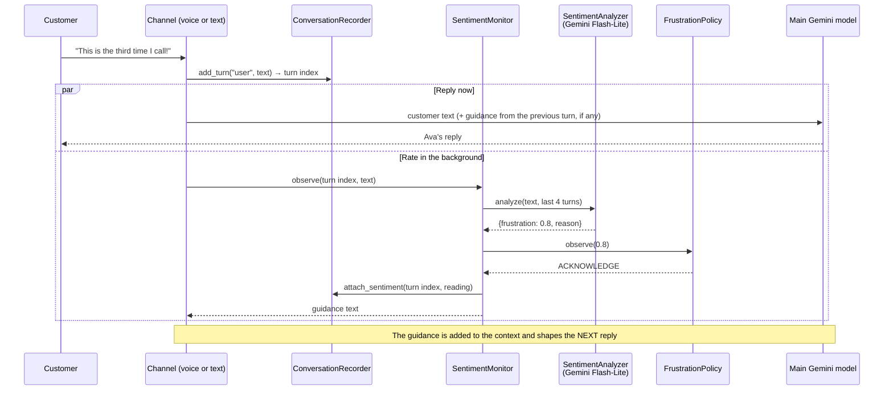

# Frustration Detection

This document describes the frustration detection feature: what it does, how it works,
where the code is, what it saves, and how to test and tune it.
For the decision and the rejected options, see [ADR-0007](../adr/0007-frustration-detection.md).

---

## 1. What it does

Ava rates every customer turn for frustration, from 0.0 (calm) to 1.0 (furious), and changes how she replies:

| Readings | Ava's next reply |
|---|---|
| Below 0.7 | No change |
| First reading ≥ 0.7 | Briefly acknowledges the frustration, then continues with the ticket |
| Two readings ≥ 0.7 in a row | Acknowledges it and **offers** a human agent, once per conversation |

The customer decides. Ava transfers the call only if the customer accepts the offer.

Every reading is saved on its transcript turn, and the end-of-call summary uses the readings to report `customer_sentiment`.

### Why

Before this feature, Ava could only react to frustration if the main model noticed it, and the summary reported sentiment only after the call.
Now frustration is measured on every turn, the reaction follows fixed rules, and the support team sees how the customer's mood changed.

---

## 2. Example from a live run

A simulated customer whose monitor is six days late (persona `growing_frustration`):

| Turn | Customer says (shortened) | Reading | Action | Ava's next reply |
|---|---|---|---|---|
| 1 | "This is the third time I'm reaching out… six days late!" | 0.8 | **acknowledge** | Sets up the ticket |
| 2 | "'Medium urgency'? Absolutely not… Change it to high!" | 0.8 | **offer_human** | "I completely understand your frustration…" |
| 3 | "Just submit it already! Stop wasting my time…" | 0.8 | none | "…Would you like me to transfer you to a human agent?" |
| 4 | "Yes, transfer me to someone who can actually help!" | 0.8 | none | Transfer message. The call ends as `escalated` |

Two details from this run:
- **The reaction comes one turn late.** The reading for turn 1 shapes the reply to turn 2. Section 4 explains why.
- **The offer is not repeated.** Turns 3 and 4 are still angry, but the policy offers a human only once.

---

## 3. How it works

### The flow for one customer turn



### The rule (`FrustrationPolicy`)

```
reading < 0.7                         → NONE, and the streak resets
first reading ≥ 0.7 in a streak       → ACKNOWLEDGE
second reading ≥ 0.7 in a row         → OFFER_HUMAN (only once per conversation)
more readings ≥ 0.7 after the offer   → NONE (the offer is not repeated)
```

The rule lives in the domain and has no AI in it, so it is predictable and easy to test.
This follows the core principle of the project ([ADR-0001](../adr/0001-code-owns-the-ticket-state.md)): **the model measures, the code decides**.

### The guidance

The guidance is an instruction for Ava, not customer speech. Each channel sends it in its own way:

| Channel | How the guidance reaches the model |
|---|---|
| Voice (Pipecat) | An `LLMMessagesAppendFrame` with a `developer` message and `run_llm=False`, so it shapes the next reply without triggering a new one |
| Text and simulations | A marked note before the customer's next message: `[Guidance for the agent, not said by the customer: …]` |

The texts are in `application/prompts.py` (`FRUSTRATION_GUIDANCE`).

### The classifier

`GeminiSentimentAnalyzer` sends the latest customer message, plus up to 4 earlier turns as context, to `gemini-3.5-flash-lite`.
It asks for structured output (`SentimentDraft`: `frustration` and `reason`) at temperature 0.
The instruction, `SENTIMENT_INSTRUCTION` in `application/sentiment.py`, defines the scale and says that speech-recognition errors are not frustration.

---

## 4. Design choices

| Choice | Reason |
|---|---|
| **A separate small model**, not the main model | The main model would grade itself, and an extra tool round would add latency to every turn |
| **Runs in the background** | The reading takes about 1 second. It runs in parallel with the reply, so the customer never waits for it |
| **Guidance applies to the next turn** | This is the cost of running in the background. A very angry customer is still covered at once by the prompt rule "if the customer is very upset, escalate" |
| **The offer is a suggestion** | An automatic transfer would surprise a customer who is annoyed but wants to finish. Only the customer's "yes" calls `escalate_to_human` |
| **Failures are invisible to the customer** | If the classifier fails or takes more than 5 seconds, the turn has no reading and the conversation continues |

---

## 5. Where the code is

Each piece sits in its hexagonal layer ([ADR-0005](../adr/0005-hexagonal-architecture.md)):

| Layer | File | What it holds |
|---|---|---|
| Domain | `domain/models.py` | `SentimentDraft`, `SentimentReading`, `FrustrationAction`, and `Turn.sentiment` |
| Domain | `domain/frustration.py` | `FrustrationPolicy`, and `sentiment_from_peak()` for the summary |
| Application | `application/ports.py` | The `SentimentAnalyzer` port. `ChatModel.send_text(..., instruction=)` |
| Application | `application/sentiment.py` | `SentimentMonitor` (the use case), `SENTIMENT_INSTRUCTION`, the 5-second timeout |
| Application | `application/prompts.py` | `FRUSTRATION_GUIDANCE` texts |
| Application | `application/recorder.py` | `add_turn()` returns the turn index. `attach_sentiment()`, `turns_before()` |
| Application | `application/agent.py` | The text loop runs the reading in parallel and keeps the guidance for the next turn |
| Application | `application/summary.py` | The readings in the summary input, and the peak in the fallback summary |
| Outbound adapter | `adapters/outbound/gemini.py` | `GeminiSentimentAnalyzer`. The guidance note in `GeminiChatModel` |
| Inbound adapter | `adapters/inbound/voice.py` | One background task per turn (`make_guidance_sender`). Waits for running readings before saving |
| Inbound adapter | `adapters/inbound/simulate.py` | The `growing_frustration` persona |
| Composition root | `bootstrap.py` | `make_sentiment_analyzer()`, and the monitor for each conversation |

---

## 6. What is saved

Each customer turn in `conversations/<id>.json` gets a `sentiment` object (from the live run above):

```json
{
  "role": "user",
  "text": "This is the third time I'm reaching out because my monitor from order ORD-208871 is six days late! ...",
  "sentiment": {
    "frustration": 0.8,
    "reason": "Customer is angry about a delayed order and repeated issues.",
    "action": "acknowledge"
  }
}
```

The summary uses the readings:
- **LLM summary:** each customer line in its input carries the score, for example `user (frustration 0.8): …`.
- **Fallback summary:** `customer_sentiment` comes from the peak reading. A peak of 0.85 or more is `angry`, 0.5 or more is `frustrated`, and anything lower is `neutral`.

---

## 7. Configuration and tuning

| Setting | Where | Default |
|---|---|---|
| Classifier model | `GEMINI_SENTIMENT_MODEL` in `.env` | `gemini-3.5-flash-lite` |
| High-frustration threshold | `HIGH_FRUSTRATION` in `domain/frustration.py` | `0.7` |
| High readings in a row before the offer | `OFFER_HUMAN_AFTER` in `domain/frustration.py` | `2` |
| Classifier timeout | `ANALYSIS_TIMEOUT_SECS` in `application/sentiment.py` | `5.0` seconds |
| Context turns sent to the classifier | `CONTEXT_TURNS` in `application/sentiment.py` | `4` |

**The thresholds are a calibration choice.** These readings come from a live sample:

| Message | Reading |
|---|---|
| "Hi, my headphones arrived with a cracked ear cup." | 0.0 |
| "Yes, that is correct, thank you." | 0.0 |
| "I already told you the order number twice." | 0.6 |
| "This is the third time I call. Nobody helps me. This is ridiculous." | 0.8 |
| "Forget it, get me a real person right now or I'm cancelling everything!" | 0.8 |

If you change a threshold, you must also update `tests/domain/test_frustration.py`.

---

## 8. How to test it

### Automated (no network)

| Test file | What it checks |
|---|---|
| `tests/domain/test_frustration.py` | The policy sequence (acknowledge, offer once, reset) and the peak-to-sentiment mapping |
| `tests/application/test_sentiment.py` | Readings are stored, guidance is returned, failures and timeouts are skipped |
| `tests/application/test_agent.py` | The guidance from one turn reaches the model on the next turn. The fallback summary uses the peak |
| `tests/adapters/test_gemini_adapter.py` | Structured-output parsing. The guidance note comes before the customer text |
| `tests/adapters/test_voice_adapter.py` | The guidance frame has `run_llm=False`. No guidance is sent after the call closes |

```bash
uv run pytest
```

### Live, with Gemini

```bash
uv run support-agent simulate --persona growing_frustration   # expects: escalated
uv run support-agent simulate                                 # all 7 personas
```

In the last full run, the five calm personas peaked at 0.0–0.3 and triggered no action.

### By voice

1. Run `uv run support-agent voice` and open <http://localhost:7860>.
2. Sound annoyed for two turns in a row, for example: *"This is the third time I call about this!"*
3. Ava acknowledges it, then offers a human.
4. Open the **Events** panel in the browser client. Each reading appears as a `serverMessage` event:
   `{"type": "frustration", "turn": 3, "frustration": 0.8, "reason": "…", "action": "acknowledge"}`.
5. The server terminal also logs each reading: `Frustration 0.8 on turn 3 (action: acknowledge): …`.
   The newest file in `conversations/` keeps all readings.

---

## 9. Limitations and next steps

| Limitation | Possible next step |
|---|---|
| Only the words are rated, not the tone of voice | Add acoustic signals (tone, volume, speech rate) in the voice channel |
| The reaction comes one turn late | Rate the turn before the reply in the text channel only, where latency matters less |
| The thresholds come from a small sample | Tune them on real calls, and track false positives |
| The readings are English-centric | Check the scores again when multilingual support is added |
