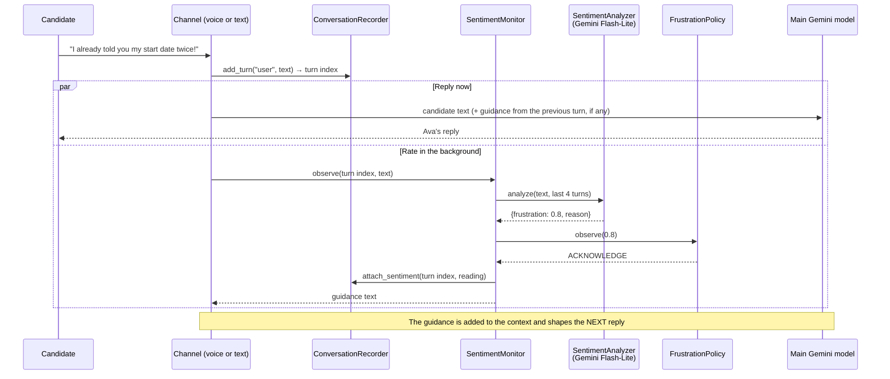

# Frustration Detection

This document describes the frustration detection feature: what it does, how it works,
where the code is, what it saves, and how to test and tune it.
For the decision and the rejected options, see [ADR-0007](../adr/0007-frustration-detection.md).

---

## 1. What it does

Ava rates every candidate turn for frustration, from 0.0 (calm) to 1.0 (furious), and changes how she replies:

| Readings | Ava's next reply |
|---|---|
| Below 0.7 | No change |
| First reading ≥ 0.7 | Briefly acknowledges the frustration, then continues with the screening |
| Two readings ≥ 0.7 in a row | Acknowledges it and **offers** a call back from a recruiter, once per conversation |

The candidate decides. Ava escalates the call only if the candidate accepts the offer.

Every reading is saved on its transcript turn, and the end-of-call summary uses the readings to report `candidate_sentiment`.

### Why

Without this feature, Ava could only react to frustration if the main model noticed it, and the summary reported sentiment only after the call.
With it, frustration is measured on every turn, the reaction follows fixed rules, and the recruiting team sees how the candidate's mood changed.

---

## 2. Example

An impatient candidate during the must-have questions. The readings are illustrative: they show how the policy reacts.

| Turn | Candidate says (shortened) | Reading | Action | Ava's next reply |
|---|---|---|---|---|
| 1 | "Why do you need all this? I already wrote it in my application!" | 0.8 | **acknowledge** | Asks the next requirement question |
| 2 | "I told you, mornings. How long does this take?" | 0.8 | **offer_human** | Acknowledges the frustration, then continues |
| 3 | "This is a waste of my time." | 0.8 | none | "…Would you prefer a call back from a recruiter?" |
| 4 | "Yes, have someone call me." | 0.3 | none | The fixed escalation message. The call ends as `escalated` |

Two details from this example:
- **The reaction comes one turn late.** The reading for turn 1 shapes the reply to turn 2. Section 4 explains why.
- **The offer is not repeated.** Turn 3 is still angry, but the policy offers a recruiter only once.

---

## 3. How it works

### The flow for one candidate turn



### The rule (`FrustrationPolicy`)

```
reading < 0.7                         → NONE, and the streak resets
first reading ≥ 0.7 in a streak       → ACKNOWLEDGE
second reading ≥ 0.7 in a row         → OFFER_HUMAN (only once per conversation)
more readings ≥ 0.7 after the offer   → NONE (the offer is not repeated)
```

The rule lives in the domain and has no AI in it, so it is predictable and easy to test.
This follows the core principle of the project ([ADR-0001](../adr/0001-code-owns-the-ticket-state.md)): **the model measures, the code decides**.

### The guidance

The guidance is an instruction for Ava, not candidate speech. Each channel sends it in its own way:

| Channel | How the guidance reaches the model |
|---|---|
| Voice (Pipecat) | An `LLMMessagesAppendFrame` with a `developer` message and `run_llm=False`, so it shapes the next reply without triggering a new one. The text has the same marked note as below |
| Text and simulations | A marked note before the candidate's next message: `[Guidance for the agent, not said by the candidate: …]` |

The texts are in `application/prompts.py` (`FRUSTRATION_GUIDANCE`).
The `OFFER_HUMAN` text tells Ava to offer a call back from a recruiter, to call `escalate_to_human` only if the candidate accepts, and to continue the screening if they decline.

### The classifier

`GeminiSentimentAnalyzer` sends the latest candidate message, plus up to 4 earlier turns as context, to `gemini-3.5-flash-lite`.
It asks for structured output (`SentimentDraft`: `frustration` and `reason`) at temperature 0.
The instruction, `SENTIMENT_INSTRUCTION` in `application/sentiment.py`, defines the scale and says that speech-recognition errors are not frustration.
It rates a message in any language the same way, and writes the reason in English.

---

## 4. Design choices

| Choice | Reason |
|---|---|
| **A separate small model**, not the main model | The main model would grade itself, and an extra tool round would add latency to every turn |
| **Runs in the background** | The reading takes about 1 second. It runs in parallel with the reply, so the candidate never waits for it |
| **Guidance applies to the next turn** | This is the cost of running in the background. A very upset candidate is still covered at once by the prompt rule "if the candidate asks for a person, is very upset, or no interview time fits, call escalate_to_human" |
| **The offer is a suggestion** | An automatic escalation would surprise a candidate who is annoyed but wants to finish the screening. Only the candidate's "yes" calls `escalate_to_human` |
| **Failures are invisible to the candidate** | If the classifier fails or takes more than 5 seconds, the turn has no reading and the conversation continues |

---

## 5. Where the code is

Each piece sits in its hexagonal layer ([ADR-0005](../adr/0005-hexagonal-architecture.md)):

| Layer | File | What it holds |
|---|---|---|
| Domain | `domain/models.py` | `SentimentDraft`, `SentimentReading`, `FrustrationAction`, and `Turn.sentiment` |
| Domain | `domain/frustration.py` | `FrustrationPolicy`, and `sentiment_from_peak()` for the summary |
| Application | `application/ports.py` | The `SentimentAnalyzer` port. `ChatModel.send_text(..., instruction=)` |
| Application | `application/sentiment.py` | `SentimentMonitor` (the use case), `SENTIMENT_INSTRUCTION`, the 5-second timeout |
| Application | `application/prompts.py` | `FRUSTRATION_GUIDANCE` texts, and `agent_note()` for the marked note |
| Application | `application/recorder.py` | `add_turn()` returns the turn index. `attach_sentiment()`, `turns_before()`, `sentiment_at()` |
| Application | `application/agent.py` | The text loop runs the reading in parallel and keeps the guidance for the next turn |
| Application | `application/summary.py` | The readings in the summary input, and the peak in the fallback summary |
| Outbound adapter | `adapters/outbound/gemini.py` | `GeminiSentimentAnalyzer`. The guidance note in `GeminiChatModel` |
| Inbound adapter | `adapters/inbound/voice.py` | One background task per turn (`make_guidance_sender`). Shows each reading in the browser. Waits for running readings before saving |
| Inbound adapter | `adapters/inbound/simulate.py` | The `wants_human` persona, who gets impatient and asks for a person |
| Composition root | `bootstrap.py` | `make_sentiment_analyzer()`, and the monitor for each conversation |

---

## 6. What is saved

Each candidate turn in `conversations/<id>.json` gets a `sentiment` object. For example:

```json
{
  "role": "user",
  "text": "I already told you my start date twice. Why do you ask again?",
  "sentiment": {
    "frustration": 0.8,
    "reason": "Candidate is annoyed about repeated questions.",
    "action": "acknowledge"
  }
}
```

The `reason` is always in English. The `text` keeps the candidate's own words and language.

The summary uses the readings:
- **LLM summary:** each candidate line in its input carries the score, for example `candidate (frustration 0.8): …`.
- **Fallback summary:** `candidate_sentiment` comes from the peak reading. A peak of 0.8 or more is `angry` (`ANGRY_PEAK`), 0.6 or more is `frustrated` (`FRUSTRATED_PEAK`), and anything lower is `neutral`. These match the classifier's scale.

---

## 7. Configuration and tuning

| Setting | Where | Default |
|---|---|---|
| Classifier model | `GEMINI_SENTIMENT_MODEL` in `.env` | `gemini-3.5-flash-lite` |
| High-frustration threshold | `HIGH_FRUSTRATION` in `domain/frustration.py` | `0.7` |
| High readings in a row before the offer | `OFFER_HUMAN_AFTER` in `domain/frustration.py` | `2` |
| Classifier timeout | `ANALYSIS_TIMEOUT_SECS` in `application/sentiment.py` | `5.0` seconds |
| Context turns sent to the classifier | `CONTEXT_TURNS` in `application/sentiment.py` | `4` |

**The thresholds are a calibration choice.** They follow the scale in `SENTIMENT_INSTRUCTION`:

| Reading | Meaning in the instruction |
|---|---|
| 0.0 | Calm or positive |
| 0.3 | Mildly annoyed |
| 0.6 | Clearly frustrated: complains, impatient, repeats themselves |
| 0.8 | Angry: blames, threatens to hang up |
| 1.0 | Furious or abusive |

The thresholds were calibrated on a live sample in the earlier customer-support version (ADR-0010). They were not measured again on screening calls.

If you change a threshold, you must also update `tests/domain/test_frustration.py`.

---

## 8. How to test it

### Automated (no network)

| Test file | What it checks |
|---|---|
| `tests/domain/test_frustration.py` | The policy sequence (acknowledge, offer once, reset) and the peak-to-sentiment mapping |
| `tests/application/test_sentiment.py` | Readings are stored, guidance is returned, a calm turn gets no guidance, failures and timeouts are skipped |
| `tests/application/test_agent.py` | The guidance from one turn reaches the model on the next turn. The reply does not wait for the reading. The fallback summary uses the peak |
| `tests/adapters/test_gemini_adapter.py` | Structured-output parsing. The guidance note comes before the candidate text |
| `tests/adapters/test_voice_adapter.py` | The guidance frame has `run_llm=False`. No guidance is sent after the call closes. Every reading is shown, and a failed display still sends the guidance |

```bash
uv run pytest
```

### Live, with Gemini

```bash
uv run screening-agent simulate --persona wants_human   # expects: escalated
uv run screening-agent simulate                         # all 7 personas
```

The `wants_human` persona asks for a person directly, so the call can escalate before the policy offers a recruiter.
Open the saved record to see the readings for each turn.

### By voice

1. Run `uv run screening-agent voice` and open <http://localhost:7860>.
2. Sound annoyed for two turns in a row, for example: *"I already told you that. How long does this take?"*
3. Ava acknowledges it, then offers a call back from a recruiter.
4. Open the **Events** panel in the browser client. Each reading appears as a `serverMessage` event:
   `{"type": "frustration", "turn": 3, "frustration": 0.8, "reason": "…", "action": "acknowledge"}`.
5. The server terminal also logs each reading: `Frustration 0.8 on turn 3 (action: acknowledge): …`.
   The newest file in `conversations/` keeps all readings.

---

## 9. Limitations and next steps

| Limitation | Possible next step |
|---|---|
| Only the words are rated, not the tone of voice | Add acoustic signals (tone, volume, speech rate) in the voice channel |
| The reaction comes one turn late | Rate the turn before the reply in the text channel only, where latency matters less |
| The thresholds come from a small sample of support calls | Tune them on real screening calls, in English and Spanish, and track false positives |
| A nervous candidate can sound like a frustrated one | Check the readings on real calls. The prompt already tells Ava to reassure a nervous candidate |
