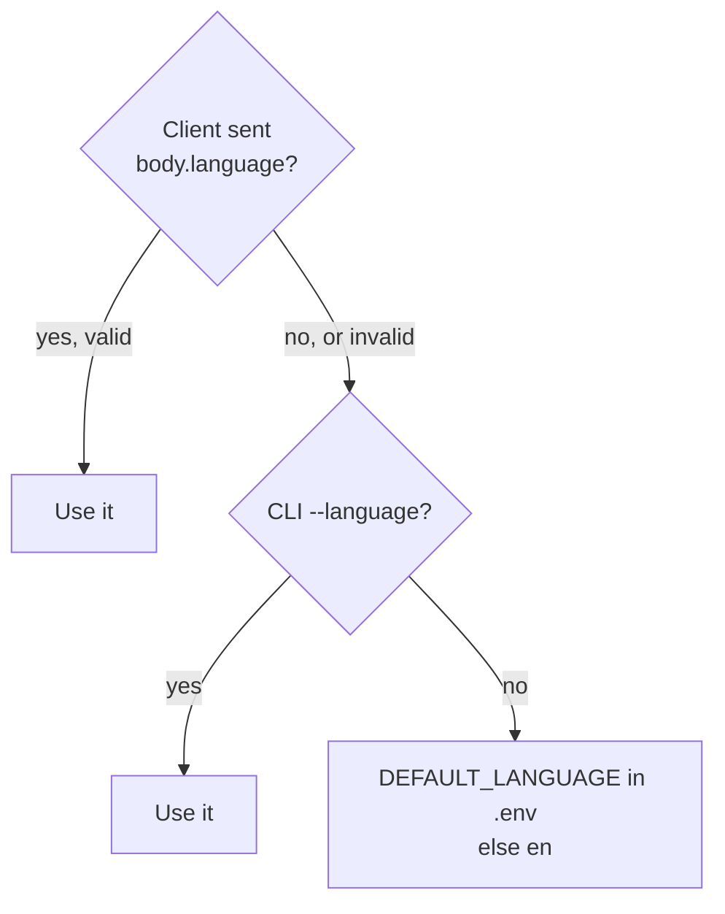
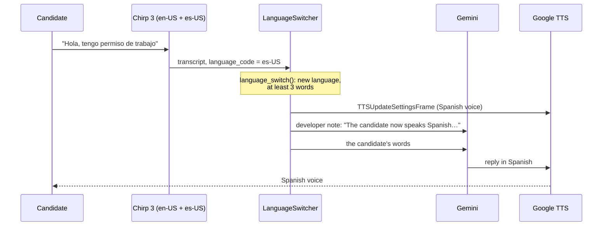

# Multiple Languages

This document describes multi-language support: what it does, how a conversation gets its language,
how a voice call switches language live, what changes per language, where the code is,
and how to test it or add a language.
For the decisions and the rejected options, see [ADR-0008](../adr/0008-language-fixed-per-conversation.md)
and [ADR-0009](../adr/0009-detect-the-language-in-voice-calls.md).

---

## 1. What it does

Ava can hold the screening call in **English** or **Spanish**.

- **Voice calls switch live.** Speech recognition detects the language of each utterance. When the candidate changes language, Ava changes her voice and her language on the same turn. No restart and no flag are needed.
- **Text chat and simulations** keep the language they start with (`--language`).

| Part of the conversation | Language |
|---|---|
| What Ava says (Gemini replies) | The candidate's current language |
| Fixed closing messages (booking time and reference, not eligible, call back from a recruiter, goodbye) | The candidate's current language, from a translated catalog |
| Speech recognition | One Chirp 3 recognizer that listens for both languages |
| Ava's voice | The voice profile of the candidate's current language |
| Tool descriptions, tool arguments, tool results, enum values | English (internal) |
| Evidence quotes on the scorecard | The candidate's own words, in the language they used |
| Answer summaries, open questions, frustration reasons, the end-of-call summary | English, for the recruiting team |

Spanish uses the formal **"usted"** everywhere, both in Gemini's replies and in the fixed messages.

---

## 2. Example

A strong candidate in Spanish (`screening-agent simulate --language es`). Ava's replies are shortened, and the last line is the fixed text from code:

```
ava:  Hola, soy Ava, la asistente de selección de Harbor Logistics… ¿Está de acuerdo en continuar?
user: Sí, de acuerdo. Me llamo Lucía Gómez.
...
user: Organicé al equipo por parejas y descargamos los dos camiones antes de abrir.
...
ava:  Perfecto. Su entrevista por videollamada con el responsable del almacén queda reservada
      para el jueves 12 de noviembre a las 10:00. Su referencia es INT-048213. Recibirá los
      detalles por correo electrónico. Gracias por su tiempo, ¡y mucha suerte!
```

The saved record has `"language": "es"`. On the scorecard, the must-have answers are canonical English values (`yes`, `morning, afternoon`), the answer summaries are in English, and the evidence quote keeps the Spanish words (`"Organicé al equipo por parejas"`). The summary is in English.

---

## 3. How a conversation gets its language

### The starting language

The starting language sets Ava's greeting. In a voice call, the candidate can change it at any time (section 3b).



| Entry point | How to choose |
|---|---|
| Voice, prebuilt browser UI | `uv run screening-agent voice`. Ava greets in the default language, then follows the candidate. `--language es` makes her greet in Spanish |
| Voice, custom client | Send `{"language": "es"}` in the session body (`/start` or `/api/offer` `requestData`). It sets the greeting language for that session |
| Text chat | `uv run screening-agent chat --language es` |
| Simulations | `uv run screening-agent simulate --language es` |
| Default for all | `DEFAULT_LANGUAGE=es` in `.env` |

Accepted values: `en`, `es`, locale forms such as `es-US`, and names such as `Spanish` or `español`.

### 3b. Live switching in a voice call



| Step | What happens |
|---|---|
| Detection | Chirp 3 gets both `en-US` and `es-US`, and reports the detected language on every final transcript |
| The rule | `language_switch()` in the domain switches only when the language changes **and** the transcript has at least 3 words (`MIN_WORDS_TO_SWITCH_LANGUAGE`). Short replies such as "ok" or "sí" give unreliable detection |
| The switch | `LanguageSwitcher` sits between STT and the user aggregator. It sends the voice change and a note for Gemini **before** the candidate's words, so the reply to this same turn is already in the new language |
| The rest of the call | The fixed closing messages and the saved record (`"language"`) follow the new language. The summary stays in English |
| Visibility | The server logs `Candidate language switched to es`. The browser's Events panel shows a `serverMessage` with `{"type": "language", "language": "es"}` |

Gemini does not switch on its own. The prompt tells it to wait for the developer note, so the voice and the words always change together.

---

## 4. What changes per language

### Voice profile (`VOICE_PROFILES` in `adapters/inbound/voice.py`)

| | English | Spanish |
|---|---|---|
| STT language (detected) | `en-US` | `es-US` |
| TTS voice | `en-US-Chirp3-HD-Aoede` | `es-US-Chirp3-HD-Aoede` |
| Phrase hints | "Harbor Logistics", "work permit", "forklift", "Getafe", "shift" | "Harbor Logistics", "permiso de trabajo", "carretilla", "Getafe", "turno" |

Speech recognition is shared: one `chirp_3` recognizer in the `us` location (`STT_MODEL`, `STT_LOCATION`). It gets every profile's language, with the starting language first, and all phrase hints.
The hints help with names and terms that speech recognition does not know. Their boost stays low (8.0), because Gemini reads the meaning from free speech.
Set `GOOGLE_STT_PHRASE_HINTS=false` in `.env` to turn them off.

**Why `chirp_3`.** The model was chosen in the earlier customer-support version, with a spoken code of letters and digits (ADR-0009).
`latest_long` misheard the code in fluent Spanish. `chirp_3` got it right in English, fluent Spanish and slow Spanish, also in streaming mode with both languages.

**The TTS language code must be set.** Pipecat's Google TTS service defaults to `en-US`, so the profile sets both the voice name and the language.

### Prompt (`application/prompts.py`)

`system_prompt(channel, job, today, language)` adds language rules: speak only the conversation language, translate tool results when speaking, keep tool arguments in English except `evidence_quote`, and answer other languages in the conversation language.
The voice channel uses `system_prompt("voice", job, today, language, switchable=True)`: start in the given language, and switch only when a developer note from `language_switch_note()` says so. It includes the register rules of every language.
`_LANGUAGE_NOTES` adds rules for one language, such as "usted" for Spanish. `greeting_trigger(job, language)` asks for the greeting in that language.

### Fixed messages (`application/messages.py`)

Each language has every candidate-facing text that code says, not Gemini:

| Text | Content |
|---|---|
| Closing messages | One for each closing stage: `BOOKED` (time and reference), `NOT_ELIGIBLE` (the requirement that is not met), `ESCALATED` (a recruiter calls back within one working day), `ENDED` (goodbye) |
| Spoken time | Weekday and month names, for example "Thursday 12 November at 10:00" or "el jueves 12 de noviembre a las 10:00" |
| Requirement reasons | The reason in the `NOT_ELIGIBLE` message, with the job's shifts and start limit |
| Retry and technical error | The reply when Gemini returns no text, and the message when the text channel fails |

Code says these messages, so the interview time, the booking reference and the reason are always exact (ADR-0001).

### Validation (`domain/validators.py`)

The validators accept the spoken and informal forms of **all** supported languages at once, whatever the conversation language:

| Input | Result |
|---|---|
| "Sí", "si, claro" | `yes` |
| "Mañanas y tardes" | `morning`, `afternoon` |
| "cualquiera", "todos" | every shift |
| "ya", "hoy", "inmediatamente" | today, as the start date |
| Evidence quote "organice al equipo por parejas" against "organicé al equipo por parejas" | Accepted |

Accents are removed before matching, so "mañana" and "manana" are the same.
Gemini converts other spoken dates ("en dos semanas") to `YYYY-MM-DD` before it calls the tool.

---

## 5. Where the code is

| Layer | File | What it holds |
|---|---|---|
| Domain | `domain/models.py` | `Language` enum. `ConversationRecord.language` |
| Domain | `domain/validators.py` | Spanish yes/no, shift and "now" words. Accent folding (`fold()`). `parse_language()`. `language_switch()` |
| Application | `application/messages.py` | `LANGUAGE_NAMES`, the closing message catalog, spoken dates, requirement reasons, retry and error messages |
| Application | `application/prompts.py` | `system_prompt(channel, job, today, language, switchable)`, `language_switch_note()`, `greeting_trigger(job, language)`, `_LANGUAGE_NOTES` |
| Application | `application/tools.py` | `ToolExecutor(language=…)` uses the catalog |
| Application | `application/recorder.py`, `agent.py` | The record stores the language. The greeting uses it |
| Application | `application/summary.py`, `sentiment.py` | The summary is always in English. Sentiment rates any language |
| Inbound adapter | `adapters/inbound/voice.py` | `VoiceProfile`, `VOICE_PROFILES`, `STT_MODEL`, `stt_languages()`, `LanguageSwitcher`, `language_switch_frames()`, `session_language()` |
| Inbound adapter | `adapters/inbound/cli.py`, `simulate.py` | `--language` on `chat`, `voice` and `simulate`. Simulated candidates speak the language |
| Config | `config.py`, `.env.example` | `DEFAULT_LANGUAGE`, `GOOGLE_STT_PHRASE_HINTS` |
| Composition root | `bootstrap.py` | `new_conversation(…, language)` passes the language to the recorder and the executor. `make_text_agent()` passes it to the prompt |

---

## 6. How to test it

### Automated (no network)

| Test file | What it checks |
|---|---|
| `tests/domain/test_validators.py` | Spanish yes/no, shift and start-date words. The quote check without accents. `parse_language`. `language_switch` (new language, same language, short reply, unsupported language, no language) |
| `tests/application/test_messages.py` | Every language has every closing message, a retry message and an error message. The spoken time in each language. The `NOT_ELIGIBLE` message for every requirement. Prompts name the language. Spanish register matches. The executor closes in the conversation language |
| `tests/application/test_agent.py` | The record keeps the conversation language |
| `tests/adapters/test_voice_adapter.py` | Every language has a voice profile with a matching locale. STT uses `chirp_3` and listens for every language. The switcher sends the voice change and the note before the words, and ignores short replies. The session language comes from the client body |

### Live

```bash
uv run screening-agent simulate --language es          # all 7 personas in Spanish
uv run screening-agent chat --language es              # talk to Ava in Spanish
```

All 7 personas must pass in English and in Spanish after a change to the prompts, the tools or the agent loop.

### Live switch by voice

1. Start `uv run screening-agent voice` and open <http://localhost:7860>. Do not use `--language`.
2. Ava greets you in English. Answer in English: "Hi, yes, I agree. My name is Lucia."
3. Change to Spanish with a full sentence: "Perdone, ¿podemos hablar en español? Sí, tengo permiso de trabajo."
4. Ava replies in Spanish with the Spanish voice. The server logs `Candidate language switched to es`.
5. Finish the screening. The closing message is in Spanish, and the record has `"language": "es"`.

A pipeline test without a microphone sent English, then Spanish speech through Pipecat's Google STT and the switcher. English caused no switch. Spanish caused the voice change and the note, in that order, before the transcript.

---

## 7. How to add a language

Example: French.

1. Add `FR = "fr"` to `Language` in `domain/models.py`.
2. In `domain/validators.py`, add `"french"` and `"francais"` to `_LANGUAGE_ALIASES`. Add French yes/no words (`_YES`, `_NO`), shift words (`_SHIFT_ALIASES`, `_ALL_SHIFTS_WORDS`, `_NO_SHIFT_WORDS`) and "now" words (`_NOW_WORDS`).
3. In `application/messages.py`, add a `Language.FR` entry to `LANGUAGE_NAMES` and to every catalog: weekdays, months, `_WHEN`, shift names, `_AND`, requirement reasons, the four closing messages, retry and technical error messages.
4. Add a `_LANGUAGE_NOTES` entry if the language needs a register rule, such as "vous".
5. Add a `VoiceProfile` with the STT language, voice and phrase hints in `adapters/inbound/voice.py`.
6. Make sure `chirp_3` supports the language. Test spoken dates and the job terms with it.
7. Run `uv run pytest`. The message and profile tests fail if a closing message, a requirement reason or a voice profile is missing.

---

## 8. Limitations and next steps

| Limitation | Possible next step |
|---|---|
| Text chat and simulations do not switch | Add the same rule to the text channel, with a text language detector |
| A mixed sentence ("my permiso is…") is detected as one language | The switch needs 3 or more words, so short mixed replies do not flip the language |
| The greeting language comes from the server default | Build a small client with a language selector that sends `body.language` |
| Only `es-US` for Spanish | Add `es-ES` or other locales as separate profiles if accents matter. The role is in Madrid, so `es-ES` is a likely next profile |
| Gemini converts spoken dates; the domain parses only `YYYY-MM-DD` and "now" words | A wrong conversion that fails the start date is read back, and the candidate can correct it |
