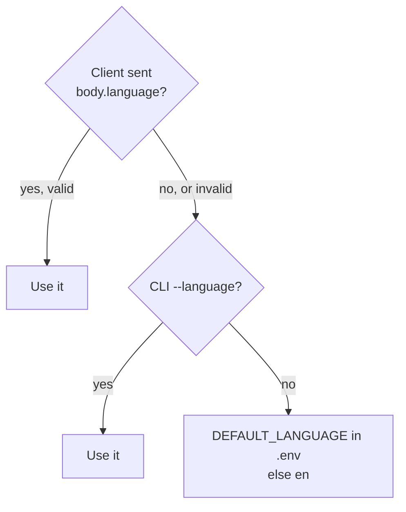
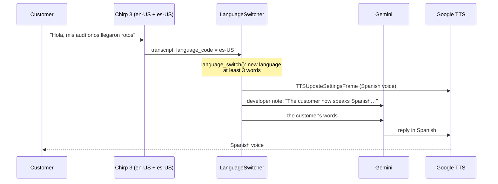

# Multiple Languages

This document describes multi-language support: what it does, how a conversation gets its language,
how a voice call switches language live, what changes per language, where the code is,
and how to test it or add a language.
For the decisions and the rejected options, see [ADR-0008](../adr/0008-language-fixed-per-conversation.md)
and [ADR-0009](../adr/0009-detect-the-language-in-voice-calls.md).

---

## 1. What it does

Ava can hold the conversation in **English** or **Spanish**.

- **Voice calls switch live.** Speech recognition detects the language of each utterance. When the customer changes language, Ava changes her voice and her language on the same turn. No restart and no flag are needed.
- **Text chat and simulations** keep the language they start with (`--language`).

| Part of the conversation | Language |
|---|---|
| What Ava says (Gemini replies) | The customer's current language |
| Fixed closing messages (ticket ID, transfer, goodbye) | The customer's current language, from a translated catalog |
| Speech recognition | One Chirp 3 recognizer that listens for both languages |
| Ava's voice | The voice profile of the customer's current language |
| Tool descriptions, tool results, category and urgency values | English (internal) |
| Frustration reasons, the end-of-call summary | English, for the support team |

Spanish uses the formal **"usted"** everywhere, both in Gemini's replies and in the fixed messages.

---

## 2. Example from a live run

The `cooperative` persona in Spanish (`support-agent simulate --language es`):

```
ava:  ¡Hola! Soy Ava de Acme Store. ¿En qué le puedo ayudar hoy?
user: Hola Ava. Mi pedido ORD-104233 de auriculares inalámbricos llegó con una grieta…
ava:  He registrado su pedido ORD-104233 por defecto de producto con urgencia media… ¿…?
user: Sí, confirmo que todos los datos son correctos. Muchas gracias.
ava:  Su ticket está registrado. La referencia es TCK-089413. Nuestro equipo se comunicará
      con usted pronto. Gracias por contactar a Acme Store. ¡Hasta luego!
```

The saved record has `"language": "es"`, the ticket has `"category": "product_defect"`, and the summary headline is in English.

---

## 3. How a conversation gets its language

### The starting language

The starting language sets Ava's greeting. In a voice call, the customer can change it at any time (section 3b).



| Entry point | How to choose |
|---|---|
| Voice, prebuilt browser UI | `uv run support-agent voice`. Ava greets in the default language, then follows the customer. `--language es` makes her greet in Spanish |
| Voice, custom client | Send `{"language": "es"}` in the session body (`/start` or `/api/offer` `requestData`). It sets the greeting language for that session |
| Text chat | `uv run support-agent chat --language es` |
| Simulations | `uv run support-agent simulate --language es` |
| Default for all | `DEFAULT_LANGUAGE=es` in `.env` |

Accepted values: `en`, `es`, locale forms such as `es-US`, and names such as `Spanish` or `español`.

### 3b. Live switching in a voice call



| Step | What happens |
|---|---|
| Detection | Chirp 3 gets both `en-US` and `es-US`, and reports the detected language on every final transcript |
| The rule | `language_switch()` in the domain switches only when the language changes **and** the transcript has at least 3 words. Short replies such as "ok" or "sí" give unreliable detection |
| The switch | `LanguageSwitcher` sits between STT and the user aggregator. It sends the voice change and a note for Gemini **before** the customer's words, so the reply to this same turn is already in the new language |
| The rest of the call | The fixed closing messages and the saved record (`"language"`) follow the new language. The summary stays in English |
| Visibility | The server logs `Customer language switched to es`. The browser's Events panel shows a `serverMessage` with `{"type": "language", "language": "es"}` |

Gemini does not switch on its own. The prompt tells it to wait for the developer note, so the voice and the words always change together.

---

## 4. What changes per language

### Voice profile (`VOICE_PROFILES` in `adapters/inbound/voice.py`)

| | English | Spanish |
|---|---|---|
| STT language (detected) | `en-US` | `es-US` |
| TTS voice | `en-US-Chirp3-HD-Charon` | `es-US-Chirp3-HD-Charon` |
| Phrase hints | "ORD", "order number", category names | "ORD", "número de pedido", envío, factura, defectuoso… |

Speech recognition is shared: one `chirp_3` recognizer in the `us` location (`STT_MODEL`, `STT_LOCATION`). It gets every profile's language, with the starting language first, and all phrase hints.

**Why `chirp_3`.** We synthesized a spoken order number and sent it to each STT model:

| STT model | English | Spanish, fluent | Spanish, slow |
|---|---|---|---|
| `latest_long` | ✅ `ORD 104233` | ❌ `o Rd 1004 233` | ✅ `o r d-104 2 3 3` |
| `chirp_3` | ✅ `ORD104233` | ✅ `ORD104233` | ✅ `ORD104233` |

`chirp_3` also worked in streaming mode, with and without phrase hints. With `en-US` and `es-US` together, it detected the right language for both samples and kept `ORD104233` intact.

**The TTS language code must be set.** Pipecat's Google TTS service defaults to `en-US`, so the profile sets both the voice name and the language.

### Prompt (`application/prompts.py`)

`system_prompt(channel, language)` adds language rules: speak only the conversation language, translate tool results when speaking, keep tool arguments in English, and answer other languages in the conversation language.
The voice channel uses `system_prompt("voice", language, switchable=True)`: start in the given language, and switch only when a developer note from `language_switch_note()` says so. It includes the register rules of every language.
`_LANGUAGE_NOTES` adds rules for one language, such as "usted" for Spanish. `greeting_trigger(language)` asks for the greeting in that language.

### Fixed messages (`application/messages.py`)

The three closing messages (ticket submitted, transfer to a human, goodbye) exist in each language.
Code says them, not Gemini, so the ticket ID is always exact (ADR-0001).

### Validation (`domain/validators.py`)

The validators accept the spoken and informal forms of **all** supported languages at once, whatever the conversation language:

| Input | Result |
|---|---|
| "mi número de pedido es O R D uno cero cuatro dos tres tres" | `ORD-104233` |
| "o erre de uno cero cuatro dos doble tres" | `ORD-104233` |
| "Envío", "dañado", "Devolución" | `shipping`, `product_defect`, `return_refund` |
| "urgente", "media", "baja" | `high`, `medium`, `low` |

Accents are removed before matching, so "número" and "numero" are the same.

---

## 5. Where the code is

| Layer | File | What changed |
|---|---|---|
| Domain | `domain/models.py` | `Language` enum. `ConversationRecord.language` |
| Domain | `domain/validators.py` | Spanish digit, filler and letter words. Spanish category and urgency aliases. Accent folding. `parse_language()`. `language_switch()` |
| Application | `application/messages.py` | New: `LANGUAGE_NAMES` and the closing message catalog |
| Application | `application/prompts.py` | `system_prompt(channel, language, switchable)`, `language_switch_note()`, `greeting_trigger(language)`, `_LANGUAGE_NOTES` |
| Application | `application/tools.py` | `ToolExecutor(language=…)` uses the catalog |
| Application | `application/recorder.py`, `agent.py` | The record stores the language. The greeting uses it |
| Application | `application/summary.py`, `sentiment.py` | The summary is always in English. Sentiment rates any language |
| Inbound adapter | `adapters/inbound/voice.py` | `VoiceProfile`, `VOICE_PROFILES`, `STT_MODEL`, `stt_languages()`, `LanguageSwitcher`, `language_switch_frames()`, `session_language()` |
| Inbound adapter | `adapters/inbound/cli.py`, `simulate.py` | `--language` on `chat`, `voice` and `simulate`. Simulated customers speak the language |
| Config | `config.py`, `.env.example` | `DEFAULT_LANGUAGE`. `GOOGLE_TTS_VOICE` and `GOOGLE_STT_LOCATION` are removed |
| Composition root | `bootstrap.py` | `new_conversation(…, language)` passes the language to the recorder, executor and prompt |

---

## 6. How to test it

### Automated (no network)

| Test file | What it checks |
|---|---|
| `tests/domain/test_validators.py` | Spanish order-number forms, Spanish aliases, `parse_language`, `language_switch` (new language, same language, short reply, unsupported language) |
| `tests/application/test_messages.py` | Every language has every closing message. Prompts name the language. Spanish register matches. The executor closes in the conversation language |
| `tests/application/test_agent.py` | The record keeps the conversation language |
| `tests/adapters/test_voice_adapter.py` | Every language has a voice profile with a matching locale. STT uses `chirp_3` and listens for every language. The switcher sends the voice change and the note before the words, and ignores short replies. The session language comes from the client body |

### Live

```bash
uv run support-agent simulate --language es          # all 7 personas in Spanish
uv run support-agent chat --language es              # talk to Ava in Spanish
```

In the last full Spanish run, all 7 personas passed.

### Live switch by voice

1. Start `uv run support-agent voice` and open <http://localhost:7860>. Do not use `--language`.
2. Ava greets you in English. Answer in English: "Hi, my headphones arrived broken."
3. Change to Spanish with a full sentence: "Perdón, ¿podemos hablar en español? Mi pedido es O R D, uno cero cuatro, dos tres tres."
4. Ava replies in Spanish with the Spanish voice. The server logs `Customer language switched to es`.
5. Finish the ticket. The closing message is in Spanish, and the record has `"language": "es"`.

A pipeline test without a microphone sent English, then Spanish speech through Pipecat's Google STT and the switcher. English caused no switch. Spanish caused the voice change and the note, in that order, before the transcript.

---

## 7. How to add a language

Example: French.

1. Add `FR = "fr"` to `Language` in `domain/models.py`.
2. Add `"french"` and `"francais"` to `_LANGUAGE_ALIASES`, plus French digit, filler and repeat words in `domain/validators.py`.
3. Add `Language.FR: "French"` to `LANGUAGE_NAMES`, and the three closing messages, in `application/messages.py`.
4. Add a `_LANGUAGE_NOTES` entry if the language needs a register rule, such as "vous".
5. Add a `VoiceProfile` with the STT language, voice and phrase hints in `adapters/inbound/voice.py`.
6. Make sure `chirp_3` supports the language, and test the spoken order number with it, as in section 4.
7. Run `uv run pytest`. The catalog and profile tests fail if a step is missing.

---

## 8. Limitations and next steps

| Limitation | Possible next step |
|---|---|
| Text chat and simulations do not switch | Add the same rule to the text channel, with a text language detector |
| A mixed sentence ("my pedido is…") is detected as one language | The switch needs 3 or more words, so short mixed replies do not flip the language |
| The greeting language comes from the server default | Build a small client with a language selector that sends `body.language` |
| Only `es-US` for Spanish | Add `es-ES` or other locales as separate profiles if accents matter |
| Grouped numbers ("ciento cuatro") are not normalized | Ava asks for the digits one by one if the lookup fails |
