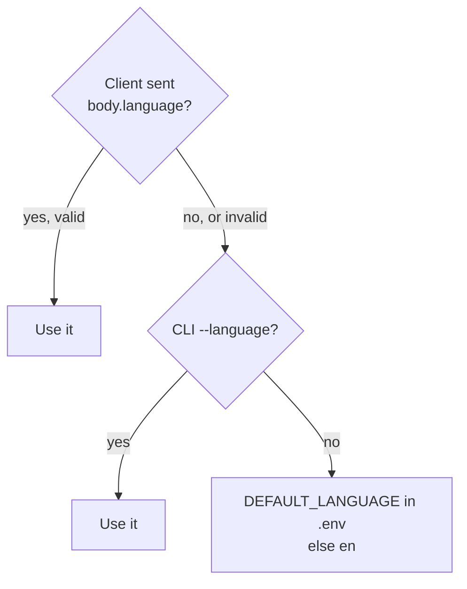

# Multiple Languages

This document describes multi-language support: what it does, how a conversation gets its language,
what changes per language, where the code is, and how to test it or add a language.
For the decision and the rejected options, see [ADR-0008](../adr/0008-language-fixed-per-conversation.md).

---

## 1. What it does

Ava can hold the whole conversation in **English** or **Spanish**. The language is fixed when the conversation starts.

| Part of the conversation | Language |
|---|---|
| What Ava says (Gemini replies) | The conversation language |
| Fixed closing messages (ticket ID, transfer, goodbye) | The conversation language, from a translated catalog |
| Speech recognition and voice | A profile for the conversation language |
| Tool descriptions, tool results, category and urgency values | English (internal) |
| Frustration reasons, the end-of-call summary | English, for the support team |

Spanish uses the formal **"usted"** everywhere, both in Gemini's replies and in the fixed messages.

---

## 2. Example from a live run

The `cooperative` persona in Spanish (`support-agent simulate --language es`):

```
ava:  ¡Hola! Soy Ava de Acme Store. ¿En qué le puedo ayudar hoy?
user: Hola Ava. Mi pedido ORD-104233 de auriculares inalámbricos llegó con una grieta…
ava:  He registrado su pedido ORD-104233 por defecto de producto con urgencia media… ¿…?
user: Sí, confirmo que todos los datos son correctos. Muchas gracias.
ava:  Su ticket está registrado. La referencia es TCK-089413. Nuestro equipo se comunicará
      con usted pronto. Gracias por contactar a Acme Store. ¡Hasta luego!
```

The saved record has `"language": "es"`, the ticket has `"category": "product_defect"`, and the summary headline is in English.

---

## 3. How a conversation gets its language



| Entry point | How to choose |
|---|---|
| Voice, prebuilt browser UI | `uv run support-agent voice --language es`. The UI has no language selector, so the whole server uses one language |
| Voice, custom client | Send `{"language": "es"}` in the session body (`/start` or `/api/offer` `requestData`). It overrides the server default |
| Text chat | `uv run support-agent chat --language es` |
| Simulations | `uv run support-agent simulate --language es` |
| Default for all | `DEFAULT_LANGUAGE=es` in `.env` |

Accepted values: `en`, `es`, locale forms such as `es-US`, and names such as `Spanish` or `español`.

---

## 4. What changes per language

### Voice profile (`VOICE_PROFILES` in `adapters/inbound/voice.py`)

| | English | Spanish |
|---|---|---|
| STT language | `en-US` | `es-US` |
| STT model | `latest_long` | `chirp_3` |
| STT location | `global` | `us` |
| TTS voice | `en-US-Chirp3-HD-Charon` | `es-US-Chirp3-HD-Charon` |
| Phrase hints | "ORD", "order number", category names | "ORD", "número de pedido", envío, factura, defectuoso… |

**Why Spanish uses `chirp_3`.** We synthesized a spoken order number and sent it to each STT model:

| STT model | English | Spanish, fluent | Spanish, slow |
|---|---|---|---|
| `latest_long` | ✅ `ORD 104233` | ❌ `o Rd 1004 233` | ✅ `o r d-104 2 3 3` |
| `chirp_3` | ✅ `ORD104233` | ✅ `ORD104233` | ✅ `ORD104233` |

`chirp_3` also worked in streaming mode, with and without phrase hints.

**The TTS language code must be set.** Pipecat's Google TTS service defaults to `en-US`, so the profile sets both the voice name and the language.

### Prompt (`application/prompts.py`)

`system_prompt(channel, language)` adds language rules: speak only the conversation language, translate tool results when speaking, keep tool arguments in English, and answer other languages in the conversation language.
`_LANGUAGE_NOTES` adds rules for one language, such as "usted" for Spanish. `greeting_trigger(language)` asks for the greeting in that language.

### Fixed messages (`application/messages.py`)

The three closing messages (ticket submitted, transfer to a human, goodbye) exist in each language.
Code says them, not Gemini, so the ticket ID is always exact (ADR-0001).

### Validation (`domain/validators.py`)

The validators accept the spoken and informal forms of **all** supported languages at once, whatever the conversation language:

| Input | Result |
|---|---|
| "mi número de pedido es O R D uno cero cuatro dos tres tres" | `ORD-104233` |
| "o erre de uno cero cuatro dos doble tres" | `ORD-104233` |
| "Envío", "dañado", "Devolución" | `shipping`, `product_defect`, `return_refund` |
| "urgente", "media", "baja" | `high`, `medium`, `low` |

Accents are removed before matching, so "número" and "numero" are the same.

---

## 5. Where the code is

| Layer | File | What changed |
|---|---|---|
| Domain | `domain/models.py` | `Language` enum. `ConversationRecord.language` |
| Domain | `domain/validators.py` | Spanish digit, filler and letter words. Spanish category and urgency aliases. Accent folding. `parse_language()` |
| Application | `application/messages.py` | New: `LANGUAGE_NAMES` and the closing message catalog |
| Application | `application/prompts.py` | `system_prompt(channel, language)`, `greeting_trigger(language)`, `_LANGUAGE_NOTES` |
| Application | `application/tools.py` | `ToolExecutor(language=…)` uses the catalog |
| Application | `application/recorder.py`, `agent.py` | The record stores the language. The greeting uses it |
| Application | `application/summary.py`, `sentiment.py` | The summary is always in English. Sentiment rates any language |
| Inbound adapter | `adapters/inbound/voice.py` | `VoiceProfile`, `VOICE_PROFILES`, `session_language()` |
| Inbound adapter | `adapters/inbound/cli.py`, `simulate.py` | `--language` on `chat`, `voice` and `simulate`. Simulated customers speak the language |
| Config | `config.py`, `.env.example` | `DEFAULT_LANGUAGE`. `GOOGLE_TTS_VOICE` and `GOOGLE_STT_LOCATION` are removed |
| Composition root | `bootstrap.py` | `new_conversation(…, language)` passes the language to the recorder, executor and prompt |

---

## 6. How to test it

### Automated (no network)

| Test file | What it checks |
|---|---|
| `tests/domain/test_validators.py` | Spanish order-number forms, Spanish aliases, `parse_language` |
| `tests/application/test_messages.py` | Every language has every closing message. Prompts name the language. Spanish register matches. The executor closes in the conversation language |
| `tests/application/test_agent.py` | The record keeps the conversation language |
| `tests/adapters/test_voice_adapter.py` | Every language has a voice profile, and its TTS voice and STT language use the same locale. Spanish uses `chirp_3`. The session language comes from the client body |

### Live

```bash
uv run support-agent simulate --language es          # all 7 personas in Spanish
uv run support-agent chat --language es              # talk to Ava in Spanish
uv run support-agent voice --language es             # open http://localhost:7860
```

In the last full Spanish run, all 7 personas passed.

---

## 7. How to add a language

Example: French.

1. Add `FR = "fr"` to `Language` in `domain/models.py`.
2. Add `"french"` and `"francais"` to `_LANGUAGE_ALIASES`, plus French digit, filler and repeat words in `domain/validators.py`.
3. Add `Language.FR: "French"` to `LANGUAGE_NAMES`, and the three closing messages, in `application/messages.py`.
4. Add a `_LANGUAGE_NOTES` entry if the language needs a register rule, such as "vous".
5. Add a `VoiceProfile` with the STT language, model, location, voice and phrase hints in `adapters/inbound/voice.py`.
6. Test the spoken order number with the STT model before you choose it, as in section 4.
7. Run `uv run pytest`. The catalog and profile tests fail if a step is missing.

---

## 8. Limitations and next steps

| Limitation | Possible next step |
|---|---|
| No language detection; one language per conversation | Detect it from the first turn and switch STT and TTS with `STTUpdateSettingsFrame` and `TTSUpdateSettingsFrame` |
| The prebuilt UI cannot choose a language | Build a small client with a language selector that sends `body.language` |
| Only `es-US` for Spanish | Add `es-ES` or other locales as separate profiles if accents matter |
| Grouped numbers ("ciento cuatro") are not normalized | Ava asks for the digits one by one if the lookup fails |
| English could also use `chirp_3` | Measure it on English calls before you switch the tested path |
