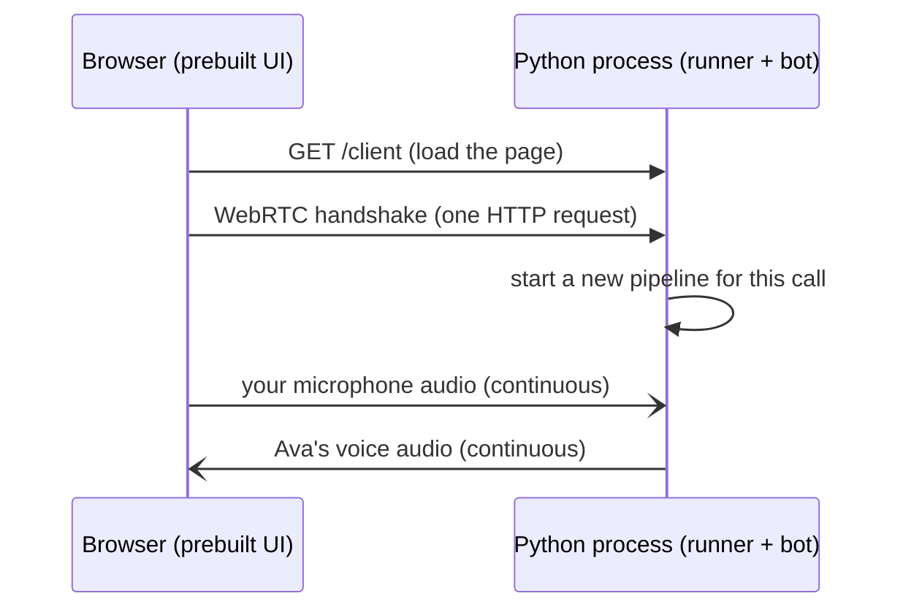
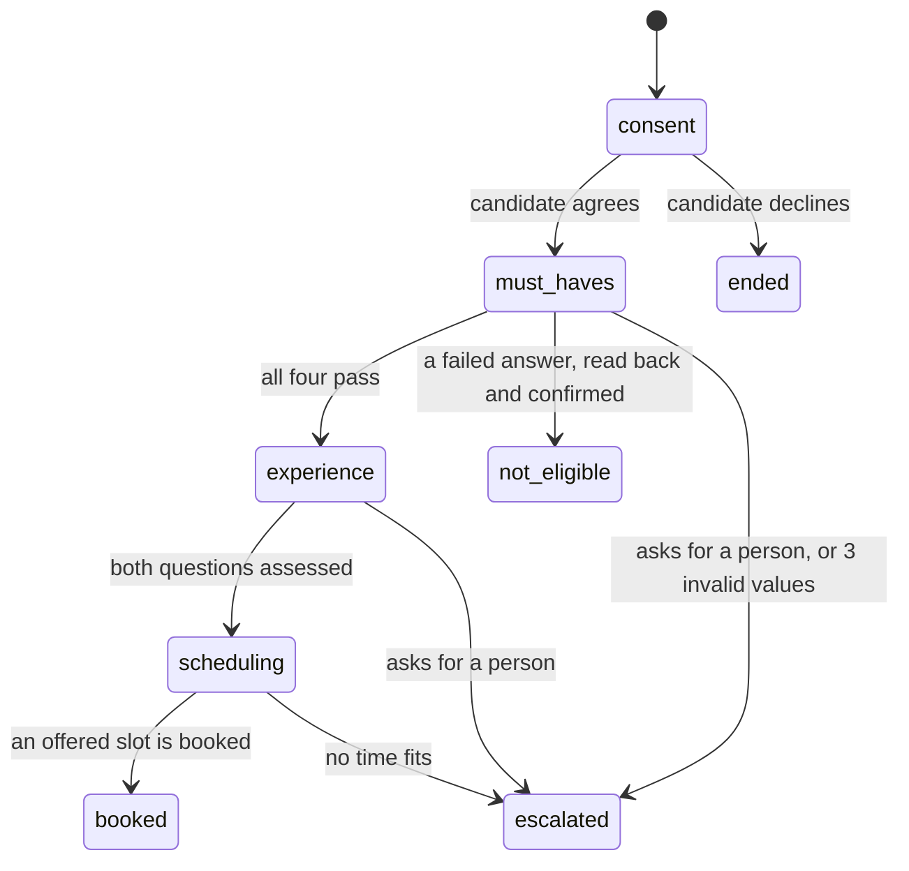
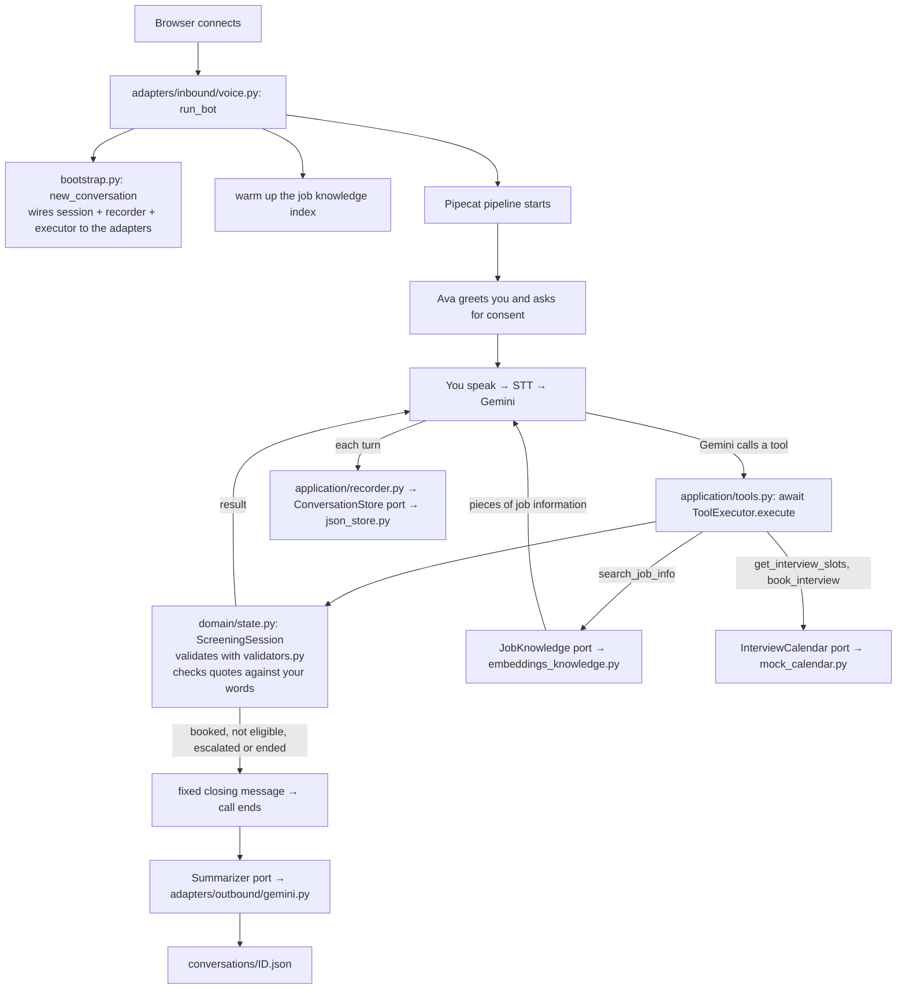
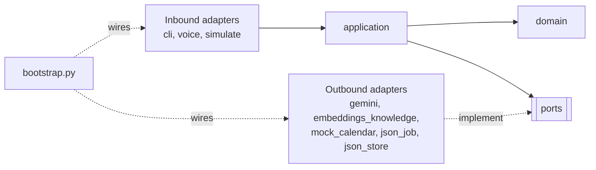

# How It Works

This guide explains the whole project, from the big picture down to the code:
what the system does, what Pipecat is, how a call flows through the code,
how the repo is organized, and a reading order for the code.

For setup and commands, see the [README](../README.md).

---

## 1. The big picture

The system is a phone-style screening call that runs in a browser. You play a job candidate, and the agent (Ava) talks to you out loud.
Ava is the recruiting assistant of the fictional company Harbor Logistics. She screens candidates for a Warehouse Operator role.
In about five minutes, she checks the must-have requirements, asks two experience questions, answers your questions about the job, and books a video interview.
The recruiter gets a scorecard with evidence quotes and a summary.

Turning speech into a scorecard takes these jobs:

| Job | Who does it |
|---|---|
| Hear: speech → text | Google Speech-to-Text (STT) |
| Think: decide what to say and what to save | Gemini (the LLM), with **our Python code** checking everything |
| Look up job facts | Vertex AI embeddings, ranked in memory by our code |
| Speak: text → speech | Google Text-to-Speech (TTS) |

Something must also move audio between the browser and Python in real time, and pass data
between these services in the right order. **That is Pipecat's job.**

---

## 2. What Pipecat is

**Pipecat is a Python framework for real-time voice agents.** Think of it as plumbing:
it connects audio input, AI services and audio output into a pipeline.

### Example

You say "I can work mornings and afternoons":

1. Audio arrives from the browser in small chunks, about every 20 ms.
2. The STT service turns the chunks into the text "I can work mornings and afternoons".
3. The LLM service sends that text to Gemini. Gemini saves the answer with a tool, then answers "Got it, thanks. When could you start?".
4. The TTS service turns the answer into audio.
5. The audio goes back to the browser.

### Pattern

Every piece of data is a **frame**: an audio chunk, a text, or a signal such as "user stopped talking".
Frames flow through a list of **processors**, and each processor transforms or reacts to frames:

```
transport.input → STT → LanguageSwitcher → user aggregator → LLM → ThoughtTagFilter → TTS
  → transport.output → assistant aggregator
```

This exact list is in [`src/screening_agent/adapters/inbound/voice.py`](../src/screening_agent/adapters/inbound/voice.py), in `run_bot()`.

### The pieces

| Pipecat concept | What it does here |
|---|---|
| **Transport** (`SmallWebRTCTransport`) | Moves audio between the browser and Python with WebRTC, the same technology video calls use |
| **Service** (`GoogleSTTService`, `GoogleVertexLLMService`, `GoogleTTSService`) | Ready-made wrappers for the Google APIs |
| **VAD** (Silero voice activity detection) | Detects when you start and stop talking, so the bot knows when your turn ends |
| **Aggregators** | Collect your words into one complete turn before they go to Gemini, and keep the **context** (the conversation history) |
| **Function calling** | When Gemini wants to use a tool (for example, save a requirement answer or search the job information), Pipecat calls our Python function and gives the result back to Gemini |
| **Interruptions** | If you talk while Ava speaks, Pipecat stops her audio |
| **Custom processors** | `LanguageSwitcher` follows the language STT detects (section 4d). `ThoughtTagFilter` removes `<thought>` tags that Gemini sometimes writes as reply text |
| **Development runner** | A small web server that starts one pipeline for each browser connection |

Without Pipecat, you would write all of this yourself: audio streaming, turn detection, interruptions and timing.

---

## 3. What the Pipecat UI (prebuilt client) is

The **prebuilt UI** is a ready-made web page that the Pipecat team ships as a Python package
(`pipecat-ai-prebuilt`). It has a **Connect** button, uses your microphone and plays the bot's audio.

We did not write any frontend. The runner serves this page at `http://localhost:7860/client`.



After the handshake, audio flows directly between the browser and Python.
There is one Python process and no separate frontend service.

---

## 4. The most important design idea

**Gemini talks, but our code decides.**

Gemini is good at conversation and bad at being reliable: it can skip a question, invent a quote, or hear a "no" that was a "yes".
So Gemini never writes the scorecard directly. It can only call **tools**, and our Python code checks every call.

### Example

Today is 2026-11-10. The job needs a start within 30 days.

```
You:     "I can start in two months."
Gemini:  calls record_must_have(requirement="start_date", answer="2027-01-10")
Code:    parses the date → later than today + 30 days → fails, but not confirmed yet
         returns {ok: true, meets_requirement: false,
                  instruction: "Repeat what you understood in neutral words..."}
Gemini:  "Just to check: you could start around January 10. Is that right?"
You:     "Oh, sorry, I meant two weeks."
Gemini:  calls record_must_have(requirement="start_date", answer="2026-11-24")
Code:    within 30 days → passes
```

A failed answer must be read back and confirmed before it closes the call, because speech recognition can mishear a "yes" or a date.
If the candidate confirms the failed answer, Gemini calls the tool again with `confirmed=true`, and the code closes the call as `not_eligible`.

Gemini also rates the experience answers, but the code checks each rating.
If Gemini sends an evidence quote that the candidate never said, the code returns
`{ok: false, error: "The evidence_quote is not in the candidate's words..."}`, and Gemini must copy real words.

### The tools Gemini can call

| Tool | Effect |
|---|---|
| `start_screening(candidate_name, consent)` | Saves the name. Moves to `must_haves`, or ends the call as `ended` without consent |
| `record_must_have(requirement, answer, confirmed?)` | Validates the answer against the job. A failure asks for a read-back first. A confirmed failure closes the call as `not_eligible` |
| `record_answer(question_id, summary, evidence_quote, specificity, score)` | Checks the quote against the candidate's words. A vague answer gets one follow-up. Saves the answer on the scorecard |
| `search_job_info(question)` | Finds job information (section 4a). No match: the question goes on the scorecard for the recruiter |
| `get_interview_slots()` | Gets free times from the calendar port. Only these times can be booked |
| `book_interview(slot_id)` | Books an offered slot, creates the booking reference, and closes the call as `booked` |
| `escalate_to_human(reason)` | Closes the call as `escalated`. A recruiter calls back |
| `end_conversation(reason)` | Closes the call as `ended`, when the candidate withdraws |

The specs are in `TOOL_SPECS` in [`application/tools.py`](../src/screening_agent/application/tools.py), with no SDK types.
`ToolExecutor.execute` is `async`: the job search waits for the embeddings service. Both channels `await` it.

### The stages

The code, not Gemini, controls the stages of the conversation (`ScreeningSession` in `domain/state.py`):



The candidate can also withdraw at any open stage (`ended`), and ask about the job at any stage.

Each tool works only in its stage. For example, Gemini cannot book an interview before the experience questions are done.
The code returns `{ok: false, error: "Not possible in stage 'must_haves'. ..."}` with the next step.
After 3 invalid values for the same field (for example, a start date that is not a date), the code escalates the call.

The closing message is fixed text from the code (`application/messages.py`), so Gemini cannot invent a time, a reference or a reason.
The booking reference (`INT-` and six digits) comes from code.

### The scorecard

The scorecard (`Scorecard` in `domain/models.py`) is what the recruiter gets:

| Field | Content |
|---|---|
| `candidate_name` | The name the candidate gave |
| `must_haves` | Each requirement with its canonical answer (`yes`, `morning, afternoon`, `2026-11-24`), `passed` and `confirmed` |
| `answers` | Each experience answer: summary (in English), evidence quote (in the candidate's words), specificity, score 1 to 4, and `follow_up_asked` |
| `open_questions` | Job questions that the job information did not answer |
| `interview`, `booking_id` | The booked time and the reference |
| `recommendation` | `advance`, `review`, `reject` or `incomplete`, from fixed rules |

The code bounds the scores and calculates the recommendation (`recommend()` in `domain/state.py`):

| Rule | Value |
|---|---|
| Follow-ups for a vague answer | 1 (`MAX_FOLLOW_UPS`) |
| Highest score for an answer that is still vague after the follow-up | 2 (`VAGUE_SCORE_CAP`) |
| `reject` | A failed must-have that the candidate confirmed |
| `incomplete` | A must-have is not passed yet, or a question is not answered yet |
| `advance` | Average score 3.0 or more (`ADVANCE_MIN_AVERAGE`), and no score below 2 (`ADVANCE_MIN_SCORE`) |
| `review` | All other complete screenings |

Ava never says a score, an assessment, or whether an answer meets a requirement. The scores never block the booking: only a must-have ends an application.
A person makes the hiring decision.

---

## 4a. Job questions (RAG)

**Example:** during the must-haves, the candidate asks *"How much does the job pay?"*

1. Gemini calls `search_job_info("How much does the job pay?")`. The tool description asks for the question in English.
2. `ToolExecutor` calls the `JobKnowledge` port: `search(question, limit=3)`, with a 4-second timeout.
3. The adapter, `GeminiJobKnowledge`, embeds the question with `gemini-embedding-001` (task type `RETRIEVAL_QUERY`).
4. It compares the question vector with each piece of [`data/job_knowledge.json`](../data/job_knowledge.json) by cosine similarity, in memory.
5. It keeps the best 3 pieces with a score of 0.68 or more (`MIN_SCORE`).
6. The tool returns `{ok: true, found: true, information: ["Pay: 1,580 euros gross per month, ..."], instruction: "Answer only from this information..."}`.
7. Ava answers in one or two sentences, then continues the screening where she stopped.

If no piece reaches the threshold, the search fails, or it takes more than 4 seconds, the tool returns `found: false`.
The question goes on the scorecard (`open_questions`), and Ava says that the recruiter will answer it. The call continues.

**The index.** The adapter embeds every piece once per process (task type `RETRIEVAL_DOCUMENT`), and every conversation shares the index.
In a voice call, the index is built while Ava greets, so the first question does not wait. In text chat, the first search builds it.

The threshold is measured: see [ADR-0011](adr/0011-job-knowledge-with-embeddings.md).

---

## 4b. Frustration detection

**Example:** the candidate says *"I already told you my start date twice. Why do you ask again?"*

1. The turn is saved, and a background task sends it to a small Gemini model.
   The model answers `{frustration: 0.8, reason: "Candidate is annoyed about repeated questions."}`.
2. The domain rule (`FrustrationPolicy`) sees the first reading ≥ 0.7 and chooses **acknowledge**.
3. The guidance goes into the conversation context as an instruction, not as candidate speech.
4. Ava's next reply starts with a short acknowledgment, then she continues the screening.
5. If the next turn is also ≥ 0.7, the rule chooses **offer a human**. Ava offers a call back from a recruiter, once.
   The candidate decides, and only a "yes" calls `escalate_to_human`.

**Pattern:** the same as the scorecard. The model measures, and the code decides.
The background task never delays a reply, so the guidance applies from the next turn.
See [the feature document](features/frustration-detection.md) and [ADR-0007](adr/0007-frustration-detection.md).

---

## 4c. Interview booking

When both experience questions are assessed, the stage moves to `scheduling`.

1. Gemini calls `get_interview_slots()`. The executor asks the `InterviewCalendar` port for up to 6 free times (`SLOT_LIMIT`).
2. `ScreeningSession.offer_slots()` remembers the offered slots and returns them with their `slot_id`.
3. Ava offers two or three times in natural words. She never reads out a slot ID.
4. Gemini calls `book_interview(slot_id)`. The session refuses a slot that it did not offer.
5. The calendar marks the slot as booked, and the call closes with the fixed message, for example:
   *"Perfect. Your video interview with the warehouse manager is booked for Thursday 12 November at 10:00. Your reference is INT-048213. ..."*

The calendar is a mock (`adapters/outbound/mock_calendar.py`). It offers 10:00, 12:30 and 16:00 on the next 3 working days.
If no time is free, the tool returns an error, and Ava escalates the call so that a recruiter calls back.

---

## 4d. Multiple languages

Ava speaks English or Spanish. The conversation starts in one language (`--language es`,
`DEFAULT_LANGUAGE`, or `{"language": "es"}` from a custom client). In a voice call, the candidate can change it
at any time: one Chirp 3 recognizer listens for both languages, and a `LanguageSwitcher` processor after STT
follows the detected language. The language selects:

- a **voice profile**: TTS voice and phrase hints;
- the **prompt's language rules**, for example the formal "usted" in Spanish;
- the **fixed closing messages** and the spoken interview time, translated in `application/messages.py`.

The inside of the system stays in English: tool arguments and results, enum values, the scorecard summaries, and the call summary.
The evidence quotes keep the candidate's own words, because the code checks them against the transcript.
Gemini translates when it speaks. See [the feature document](features/multi-language.md),
[ADR-0008](adr/0008-language-fixed-per-conversation.md) and [ADR-0009](adr/0009-detect-the-language-in-voice-calls.md).

---

## 5. How one voice call flows through the code



---

## 6. Repo organization: hexagonal architecture

The code follows **hexagonal architecture**, also called **ports and adapters**.

### Example → pattern → explanation

**Example:** the recorder must save a conversation. It does not know about JSON files.
It calls `store.save(record)` on a `ConversationStore`. Today, `JsonConversationStore` answers that call.
Tomorrow, a `FirestoreConversationStore` can answer it, and the recorder does not change.

**Pattern:**

| Term | Meaning | In this repo |
|---|---|---|
| **Domain** | Pure business rules | `domain/`: the screening state machine, the recommendation, validators, data models |
| **Application** | Use cases that coordinate the domain | `application/`: tools, agent loop, recorder, summary rules, sentiment, prompts, messages |
| **Port** | An interface the application needs from the outside | `application/ports.py`: `JobKnowledge`, `InterviewCalendar`, `ConversationStore`, `ChatModel`, `Summarizer`, `SentimentAnalyzer` |
| **Inbound adapter** (driving) | Something that calls the application | `adapters/inbound/`: CLI, voice (Pipecat), simulations |
| **Outbound adapter** (driven) | Something the application calls, through a port | `adapters/outbound/`: Gemini, embeddings knowledge, mock calendar, JSON store |
| **Composition root** | The one place that connects adapters to ports | `bootstrap.py` |

`json_job.py` is an outbound adapter with no port: `bootstrap.py` loads the `JobPosting` once and passes it to each `ScreeningSession`.

**Explanation:** dependencies point **inward only**.



- The domain imports nothing from the project, and no SDK.
- The application imports the domain and its own ports. It never imports Pipecat, Google or an adapter.
- Adapters import the application. The application never imports an adapter.
- `tests/test_architecture.py` fails if any file breaks these rules.

### The folders

```
screening-agent/
├── src/screening_agent/
│   ├── domain/                  Pure rules. No AI, no audio, no files
│   │   ├── models.py            Data shapes: JobPosting, Scorecard, ConversationRecord, Summary
│   │   ├── validators.py        Cleans and checks values ("Mañanas y tardes" → morning, afternoon)
│   │   ├── state.py             ScreeningSession: stages, validation, read-back, quote check,
│   │   │                        3-failure escalation, the recommendation
│   │   └── frustration.py       When to acknowledge frustration or offer a recruiter
│   │
│   ├── application/             Use cases. Talks to the outside only through ports
│   │   ├── ports.py             The interfaces: JobKnowledge, InterviewCalendar, ConversationStore,
│   │   │                        ChatModel, Summarizer, SentimentAnalyzer
│   │   ├── tools.py             The 8 tools Gemini can call + the async ToolExecutor
│   │   ├── agent.py             TextAgent: the turn loop for text and simulations
│   │   ├── recorder.py          Collects transcript + tool calls, saves after each turn
│   │   ├── summary.py           What the summarizer receives + the rule-based fallback
│   │   ├── sentiment.py         Rates each candidate turn for frustration, in the background
│   │   ├── prompts.py           Instructions for Gemini (call flow, voice, rules, language)
│   │   └── messages.py          Fixed closing messages and spoken dates for each language
│   │
│   ├── adapters/
│   │   ├── inbound/             How candidates and operators reach the app
│   │   │   ├── cli.py           The commands: chat | voice | simulate
│   │   │   ├── voice.py         The Pipecat pipeline
│   │   │   └── simulate.py      Simulated candidates (Gemini plays them) + an LLM judge
│   │   └── outbound/            How the app reaches the outside world
│   │       ├── gemini.py        Vertex AI client + chat, summary and sentiment adapters
│   │       ├── embeddings_knowledge.py  Job search with Vertex AI embeddings
│   │       ├── mock_calendar.py Free interview times on the next working days
│   │       ├── json_job.py      Reads the job posting (data/job.json)
│   │       └── json_store.py    Writes conversation files safely
│   │
│   ├── bootstrap.py             Connects the adapters to the ports
│   └── config.py                Reads settings from .env
│
├── tests/                       183 tests, no internet needed. Same folders as the code
│   ├── domain/  application/  adapters/
│   └── test_architecture.py     Checks that every import points inward
├── data/job.json                The role: required shifts, start limit, experience questions
├── data/job_knowledge.json      Job information for the job search (14 pieces)
├── docs/                        This guide
├── conversations/               Your real call records (not in Git)
├── .env                         Your settings (project ID). Not in Git
└── README.md                    Setup, architecture, design decisions
```

### The data files

| File | Content | Who reads it |
|---|---|---|
| `data/job.json` | Company, title, site, summary, `required_shifts` (`morning`, `afternoon`), `max_start_days` (30), and the two experience questions (`teamwork`, `safety`), each with what a strong answer shows | `json_job.py` → `ScreeningSession` and the system prompt |
| `data/job_knowledge.json` | Short pieces of job information, each with an `id` and a `text`: pay, shifts, location, contract, tasks, training, equipment, holidays, and more | `embeddings_knowledge.py` → the job search |

The job is data, not code. A new role needs new files, and no code change. `JOB_PATH` and `KNOWLEDGE_PATH` in `.env` can point to other files.

### One detail: how the domain reads the candidate's words without a port

`ScreeningSession` must check each evidence quote against what the candidate said, but the domain must not import the recorder.
So it receives a plain function, `candidate_words() -> list[str]` (the type `CandidateWords`).
`bootstrap.py` passes a function that returns `recorder.candidate_texts()`, and the tests pass a fixture with a list of lines.

### What this buys you

| Change | Files that change |
|---|---|
| Replace Gemini with another LLM | A new outbound adapter + one line in `bootstrap.py` |
| Save conversations in a database | A new `ConversationStore` adapter + one line in `bootstrap.py` |
| Use Google Calendar for interviews | A new `InterviewCalendar` adapter + one line in `bootstrap.py` |
| Move the job search to a vector store | A new `JobKnowledge` adapter + one line in `bootstrap.py` |
| Add a phone channel (Twilio) | A new inbound adapter |
| Change a business rule | `domain/` only, plus its tests |

---

## 7. The text channel and why it exists

`uv run screening-agent chat` runs the same agent without audio. It is faster and cheaper for testing
prompts and rules. It uses `TextAgent` with the `GeminiChatModel` adapter instead of Pipecat, but it calls the **same**
`ToolExecutor` and `ScreeningSession`.

`uv run screening-agent simulate` uses the same `TextAgent` so that Gemini can play difficult candidates
automatically: strong, vague then specific (needs a follow-up), no work permit, corrects a misheard start date,
asks many questions (one with no answer), wants a person, and tries to game the score.
A run passes only if the final status is right **and** an LLM judge passes six criteria:
natural tone, follow-ups, no leaks, no protected topics, grounded job answers, and a faithful scorecard.

---

## 8. What a saved record contains

Each file in `conversations/` has these keys:

| Key | Meaning |
|---|---|
| `id`, `channel`, `language`, `job_id` | Which call, on which channel, in which language, for which role |
| `status` | `in_progress`, `booked`, `not_eligible`, `escalated`, `ended` or `abandoned` (the call dropped while open) |
| `stage` | The last stage of the state machine |
| `started_at`, `ended_at` | When the call started and ended |
| `scorecard` | The must-haves, the assessed answers, the open questions, the interview and the recommendation |
| `close_reason` | Why the call closed, in English |
| `transcript` | Every line said, with timestamps and frustration readings |
| `tool_calls` | Every tool Gemini called, with its arguments and result |
| `validation_events` | Every rejected value and why |
| `summary` | Headline, key points, candidate sentiment, next action |

The recorder saves after each turn, so a dropped call keeps a partial record.

---

## 9. Suggested reading order

Read from the center outward, the same direction as the dependencies:

1. [`domain/models.py`](../src/screening_agent/domain/models.py): what the data looks like.
2. [`domain/state.py`](../src/screening_agent/domain/state.py): the rules, the heart of the system.
3. [`application/ports.py`](../src/screening_agent/application/ports.py): what the core needs from the outside.
4. [`application/tools.py`](../src/screening_agent/application/tools.py): how Gemini reaches the rules and the job search.
5. [`application/agent.py`](../src/screening_agent/application/agent.py) (`TextAgent._run`): the simplest agent loop.
6. [`bootstrap.py`](../src/screening_agent/bootstrap.py): which adapter fills which port.
7. [`adapters/outbound/embeddings_knowledge.py`](../src/screening_agent/adapters/outbound/embeddings_knowledge.py): the job search.
8. [`adapters/inbound/voice.py`](../src/screening_agent/adapters/inbound/voice.py): the same idea inside Pipecat.
9. [`tests/domain/test_state.py`](../tests/domain/test_state.py): each rule shown as a short example.

---

## Glossary

| Term | Meaning |
|---|---|
| **ADC** | Application Default Credentials: your local Google login that the code uses automatically |
| **Adapter** | Code that connects the application to one technology (Gemini, Pipecat, embeddings, JSON files) |
| **Composition root** | The one module that creates the adapters and connects them to the ports (`bootstrap.py`) |
| **Embedding** | A list of numbers that represents the meaning of a text. Texts with similar meaning have similar embeddings |
| **Evidence quote** | Three to fifteen words that the candidate said, which support a score. The code checks that they are in the transcript |
| **Frame** | One unit of data in a Pipecat pipeline (audio chunk, text, control signal) |
| **Must-have** | A requirement that ends the application when it fails: work permit, shifts, start date, commute |
| **Pipeline** | The ordered list of processors that frames flow through |
| **Port** | An interface the application needs from the outside world (`application/ports.py`) |
| **RAG** | Retrieval-augmented generation: the agent finds relevant text first, then answers only from it |
| **Scorecard** | What the recruiter gets: must-haves, assessed answers, open questions, interview and recommendation |
| **STT / TTS** | Speech-to-text / text-to-speech |
| **Tool / function calling** | The LLM asks the code to run a named function with arguments and gets the result back |
| **Transport** | The part of Pipecat that moves audio in and out (here: WebRTC to the browser) |
| **VAD** | Voice activity detection: finds when a person starts and stops talking |
| **Vertex AI** | Google Cloud's AI platform, where Gemini and the embedding model run |
| **WebRTC** | Browser technology for real-time audio and video |
