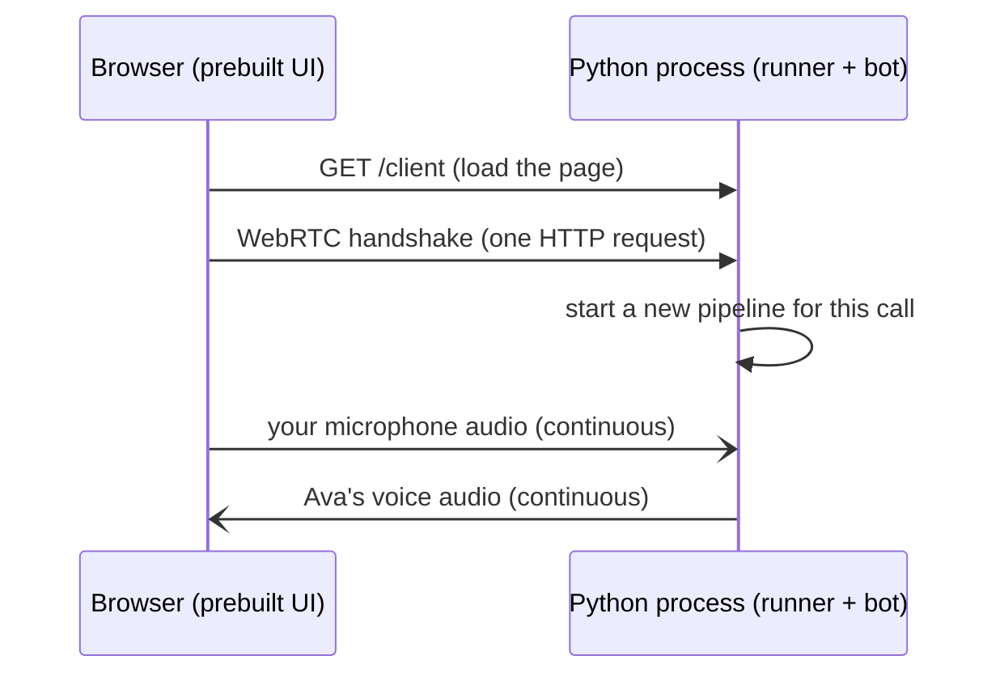
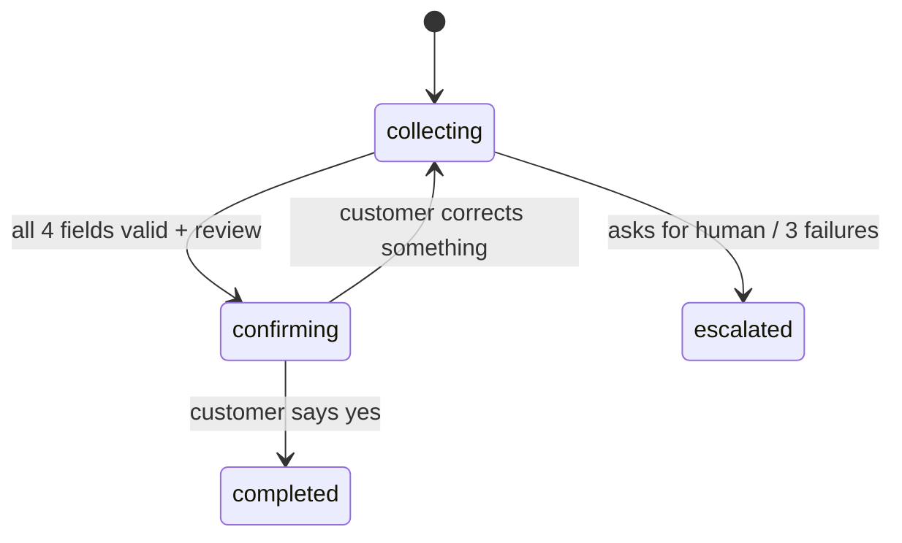
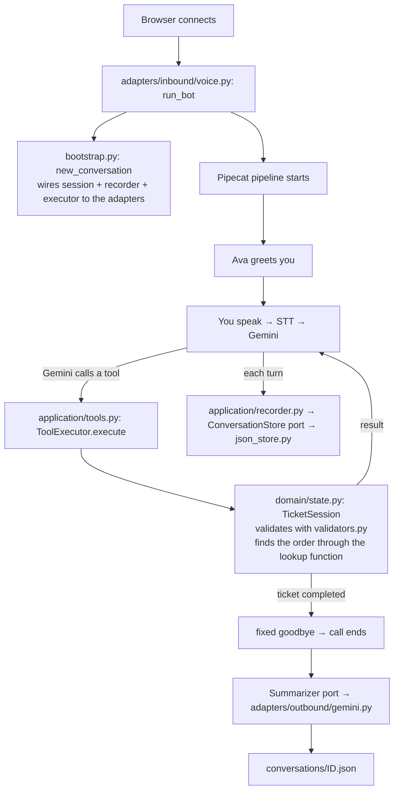
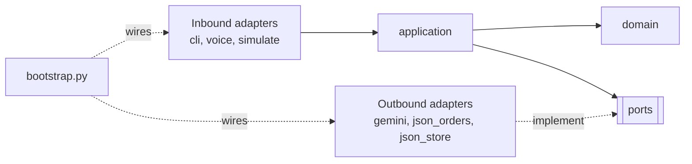

# How It Works

This guide explains the whole project, from the big picture down to the code:
what the system does, what Pipecat is, how a call flows through the code,
how the repo is organized, and a reading order for the code.

For setup and commands, see the [README](../README.md).

---

## 1. The big picture

The system is a phone-style support line that runs in a browser. You talk, and the agent (Ava) answers out loud.
She collects four facts about your problem and saves a ticket.

Turning speech into a ticket takes three jobs:

| Job | Who does it |
|---|---|
| Hear: speech → text | Google Speech-to-Text (STT) |
| Think: decide what to say and what to save | Gemini (the LLM), with **our Python code** checking everything |
| Speak: text → speech | Google Text-to-Speech (TTS) |

Something must also move audio between the browser and Python in real time, and pass data
between these services in the right order. **That is Pipecat's job.**

---

## 2. What Pipecat is

**Pipecat is a Python framework for real-time voice agents.** Think of it as plumbing:
it connects audio input, AI services and audio output into a pipeline.

### Example

You say "my headphones broke":

1. Audio arrives from the browser in small chunks, about every 20 ms.
2. The STT service turns the chunks into the text "my headphones broke".
3. The LLM service sends that text to Gemini and gets the answer "Sorry to hear that…".
4. The TTS service turns the answer into audio.
5. The audio goes back to the browser.

### Pattern

Every piece of data is a **frame**: an audio chunk, a text, or a signal such as "user stopped talking".
Frames flow through a list of **processors**, and each processor transforms or reacts to frames:

```
transport.input → STT → user aggregator → LLM → TTS → transport.output → assistant aggregator
```

This exact list is in [`src/support_agent/adapters/inbound/voice.py`](../src/support_agent/adapters/inbound/voice.py), in `run_bot()`.

### The pieces

| Pipecat concept | What it does here |
|---|---|
| **Transport** (`SmallWebRTCTransport`) | Moves audio between the browser and Python with WebRTC, the same technology video calls use |
| **Service** (`GoogleSTTService`, `GoogleVertexLLMService`, `GoogleTTSService`) | Ready-made wrappers for the Google APIs |
| **VAD** (Silero voice activity detection) | Detects when you start and stop talking, so the bot knows when your turn ends |
| **Aggregators** | Collect your words into one complete turn before they go to Gemini, and keep the **context** (the conversation history) |
| **Function calling** | When Gemini wants to use a tool (e.g. look up an order), Pipecat calls our Python function and gives the result back to Gemini |
| **Interruptions** | If you talk while Ava speaks, Pipecat stops her audio |
| **Development runner** | A small web server that starts one pipeline for each browser connection |

Without Pipecat, you would write all of this yourself: audio streaming, turn detection, interruptions and timing.

---

## 3. What the Pipecat UI (prebuilt client) is

The **prebuilt UI** is a ready-made web page that the Pipecat team ships as a Python package
(`pipecat-ai-prebuilt`). It has a **Connect** button, uses your microphone and plays the bot's audio.

We did not write any frontend. The runner serves this page at `http://localhost:7860/client`.



After the handshake, audio flows directly between the browser and Python.
There is one Python process and no separate frontend service.

---

## 4. The most important design idea

**Gemini talks, but our code decides.**

Gemini is good at conversation and bad at being reliable: it can invent an order number or skip a question.
So Gemini never writes the ticket directly. It can only call **tools**, and our Python code checks every call.

### Example

```
You:     "My order is O R D one zero four, two three three"
Gemini:  calls lookup_order("O R D one zero four, two three three")
Code:    normalizes it → "ORD-104233" → finds it in orders.json → OK
         returns {ok: true, order: {customer: "Maria Lopez", status: "delivered", ...}}
Gemini:  "Thanks Maria, I see your headphones were delivered on October 16..."
```

If the number does not exist, the code returns `{ok: false, error: "No order ORD-104323 exists"}`,
and Gemini asks you again.

### The tools Gemini can call

| Tool | Effect |
|---|---|
| `lookup_order(order_number)` | Normalizes the number, finds the order, attaches it to the ticket |
| `update_ticket(category?, description?, urgency?)` | Saves fields. Each one is validated separately |
| `review_ticket()` | Refused if a field is missing. Otherwise moves to `confirming` and returns the ticket to read back |
| `finalize_ticket()` | Refused unless the stage is `confirming`. Creates the ticket ID |
| `escalate_to_human(reason)` | Ends the conversation as `escalated` |
| `end_conversation(reason)` | Ends the conversation without a ticket |

### The stages

The code, not Gemini, controls the stages of the conversation:



Gemini cannot submit a ticket unless the code says the stage is `confirming`,
which means Ava has read the ticket back to you.
The final goodbye with the ticket number is fixed text from the code, so Gemini cannot invent a reference number.

---

## 4b. Frustration detection

**Example:** the customer says *"This is the third time I call. Nobody helps me."*

1. The turn is saved, and a background task sends it to a small Gemini model.
   The model answers `{frustration: 0.8, reason: "repeated unhelpful calls"}`.
2. The domain rule (`FrustrationPolicy`) sees the first reading ≥ 0.7 and chooses **acknowledge**.
3. The guidance goes into the conversation context as an instruction, not as customer speech.
4. Ava's next reply starts with *"I completely understand your frustration…"*.
5. If the next turn is also ≥ 0.7, the rule chooses **offer a human**. Ava offers a transfer once.
   The customer decides, and only a "yes" calls `escalate_to_human`.

**Pattern:** the same as the ticket. The model measures, and the code decides.
The background task never delays a reply, so the guidance applies from the next turn.
See [the feature document](features/frustration-detection.md) and [ADR-0007](adr/0007-frustration-detection.md).

---

## 5. How one voice call flows through the code



---

## 6. Repo organization: hexagonal architecture

The code follows **hexagonal architecture**, also called **ports and adapters**.

### Example → pattern → explanation

**Example:** the recorder must save a conversation. It does not know about JSON files.
It calls `store.save(record)` on a `ConversationStore`. Today, `JsonConversationStore` answers that call.
Tomorrow, a `FirestoreConversationStore` can answer it, and the recorder does not change.

**Pattern:**

| Term | Meaning | In this repo |
|---|---|---|
| **Domain** | Pure business rules | `domain/`: the ticket state machine, validators, data models |
| **Application** | Use cases that coordinate the domain | `application/`: tools, agent loop, recorder, summary rules, prompts |
| **Port** | An interface the application needs from the outside | `application/ports.py`: `OrderRepository`, `ConversationStore`, `ChatModel`, `Summarizer`, `SentimentAnalyzer` |
| **Inbound adapter** (driving) | Something that calls the application | `adapters/inbound/`: CLI, voice (Pipecat), simulations |
| **Outbound adapter** (driven) | Something the application calls, through a port | `adapters/outbound/`: Gemini, JSON orders, JSON store |
| **Composition root** | The one place that connects adapters to ports | `bootstrap.py` |

**Explanation:** dependencies point **inward only**.



- The domain imports nothing from the project, and no SDK.
- The application imports the domain and its own ports. It never imports Pipecat, Google or an adapter.
- Adapters import the application. The application never imports an adapter.
- `tests/test_architecture.py` fails if any file breaks these rules.

### The folders

```
orbio-case/
├── src/support_agent/
│   ├── domain/                  Pure rules. No AI, no audio, no files
│   │   ├── models.py            Data shapes: Order, Ticket, ConversationRecord, Summary
│   │   ├── validators.py        Cleans and checks values ("o r d one…" → ORD-104233)
│   │   ├── state.py             The rules: stages, validation, 3-failure escalation
│   │   └── frustration.py       When to acknowledge frustration or offer a human
│   │
│   ├── application/             Use cases. Talks to the outside only through ports
│   │   ├── ports.py             The interfaces: OrderRepository, ConversationStore, ChatModel,
│   │   │                        Summarizer, SentimentAnalyzer
│   │   ├── tools.py             The 6 tools Gemini can call + ToolExecutor
│   │   ├── agent.py             TextAgent: the turn loop for text and simulations
│   │   ├── recorder.py          Collects transcript + tool calls, saves after each turn
│   │   ├── summary.py           What the summarizer receives + the rule-based fallback
│   │   ├── sentiment.py         Rates each customer turn for frustration, in the background
│   │   └── prompts.py           Instructions for Gemini (personality, rules)
│   │
│   ├── adapters/
│   │   ├── inbound/             How customers and operators reach the app
│   │   │   ├── cli.py           The commands: chat | voice | simulate
│   │   │   ├── voice.py         The Pipecat pipeline
│   │   │   └── simulate.py      Fake customers (Gemini plays them) to test the agent
│   │   └── outbound/            How the app reaches the outside world
│   │       ├── gemini.py        Vertex AI client + chat, summary and sentiment adapters
│   │       ├── json_orders.py   Reads the fake order database (data/orders.json)
│   │       └── json_store.py    Writes conversation files safely
│   │
│   ├── bootstrap.py             Connects the adapters to the ports
│   └── config.py                Reads settings from .env
│
├── tests/                       90 tests, no internet needed. Same folders as the code
│   ├── domain/  application/  adapters/
│   └── test_architecture.py     Checks that every import points inward
├── data/orders.json             10 fake orders
├── docs/                        This guide
├── examples/                    A sample saved conversation
├── conversations/               Your real call records (not in Git)
├── .env                         Your settings (project ID). Not in Git
└── README.md                    Setup, architecture, design decisions
```

### One detail: how the domain finds orders without a port

`TicketSession` must look up orders, but the domain must not import a port from the application.
So it receives a plain function, `find_order(order_number) -> Order | None`.
`bootstrap.py` passes `JsonOrderRepository.get`, and the tests pass the same method from a fixture.

### What this buys you

| Change | Files that change |
|---|---|
| Replace Gemini with another LLM | A new outbound adapter + one line in `bootstrap.py` |
| Save conversations in a database | A new `ConversationStore` adapter + one line in `bootstrap.py` |
| Add a phone channel (Twilio) | A new inbound adapter |
| Change a business rule | `domain/` only, plus its tests |

---

## 7. The text channel and why it exists

`uv run support-agent chat` runs the same agent without audio. It is faster and cheaper for testing
prompts and rules. It uses `TextAgent` with the `GeminiChatModel` adapter instead of Pipecat, but it calls the **same**
`ToolExecutor` and `TicketSession`.

`uv run support-agent simulate` uses the same `TextAgent` so that Gemini can play difficult customers
automatically: cooperative, wrong order number, correction during read-back, rambling,
demands a human, and never gives a valid order number.

---

## 8. What a saved record contains

Each file in `conversations/` has these keys:

| Key | Meaning |
|---|---|
| `status` | `completed`, `escalated` or `abandoned` |
| `ticket` | The four validated fields + ticket ID |
| `transcript` | Every line said, with timestamps |
| `tool_calls` | Every tool Gemini called, with its arguments and result |
| `validation_events` | Every rejected value and why |
| `summary` | Headline, key points, sentiment, next action |

See [`examples/sample_conversation.json`](../examples/sample_conversation.json) for a full example.

---

## 9. Suggested reading order

Read from the center outward, the same direction as the dependencies:

1. [`domain/models.py`](../src/support_agent/domain/models.py): what the data looks like.
2. [`domain/state.py`](../src/support_agent/domain/state.py): the rules, the heart of the system.
3. [`application/ports.py`](../src/support_agent/application/ports.py): what the core needs from the outside.
4. [`application/tools.py`](../src/support_agent/application/tools.py): how Gemini reaches the rules.
5. [`application/agent.py`](../src/support_agent/application/agent.py) (`TextAgent._run`): the simplest agent loop.
6. [`bootstrap.py`](../src/support_agent/bootstrap.py): which adapter fills which port.
7. [`adapters/inbound/voice.py`](../src/support_agent/adapters/inbound/voice.py): the same idea inside Pipecat.
8. [`tests/domain/test_state.py`](../tests/domain/test_state.py): each rule shown as a short example.

---

## Glossary

| Term | Meaning |
|---|---|
| **ADC** | Application Default Credentials: your local Google login that the code uses automatically |
| **Adapter** | Code that connects the application to one technology (Gemini, Pipecat, JSON files) |
| **Composition root** | The one module that creates the adapters and connects them to the ports (`bootstrap.py`) |
| **Frame** | One unit of data in a Pipecat pipeline (audio chunk, text, control signal) |
| **Pipeline** | The ordered list of processors that frames flow through |
| **Port** | An interface the application needs from the outside world (`application/ports.py`) |
| **STT / TTS** | Speech-to-text / text-to-speech |
| **Tool / function calling** | The LLM asks the code to run a named function with arguments and gets the result back |
| **Transport** | The part of Pipecat that moves audio in and out (here: WebRTC to the browser) |
| **VAD** | Voice activity detection: finds when a person starts and stops talking |
| **Vertex AI** | Google Cloud's AI platform, where Gemini runs |
| **WebRTC** | Browser technology for real-time audio and video |
